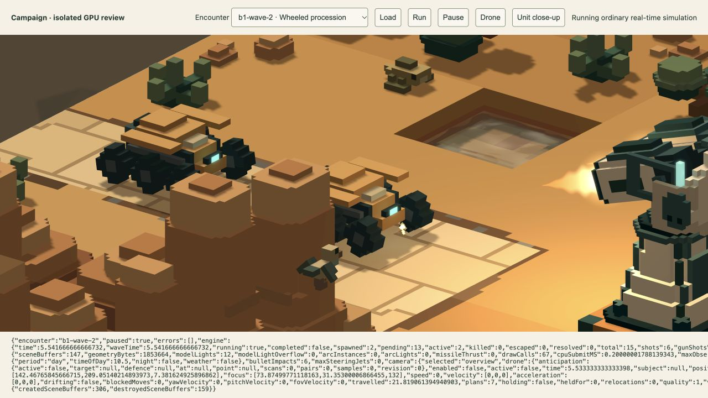
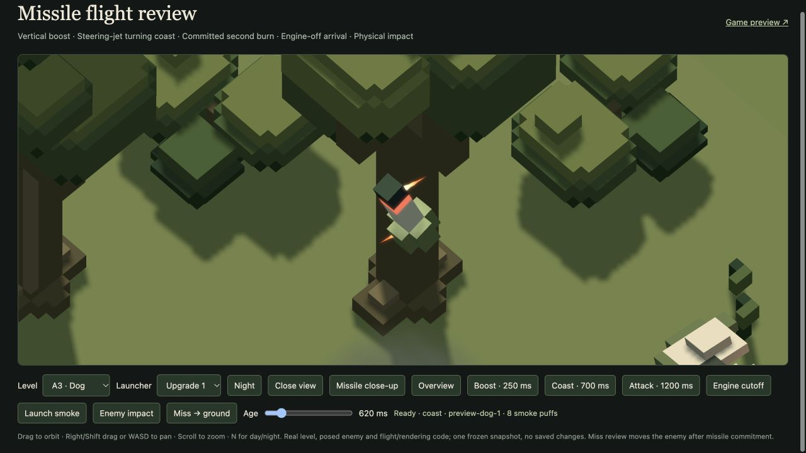
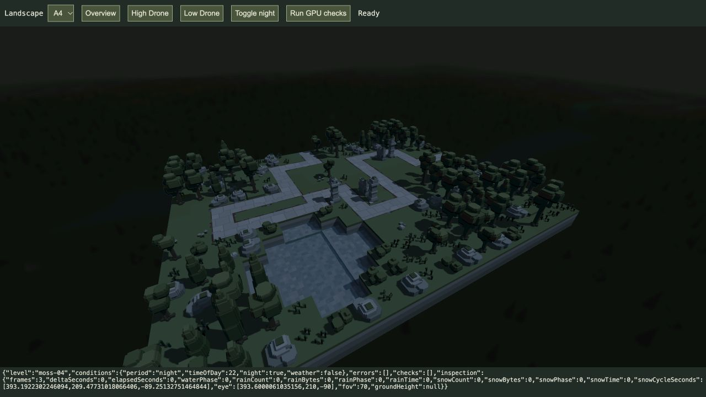
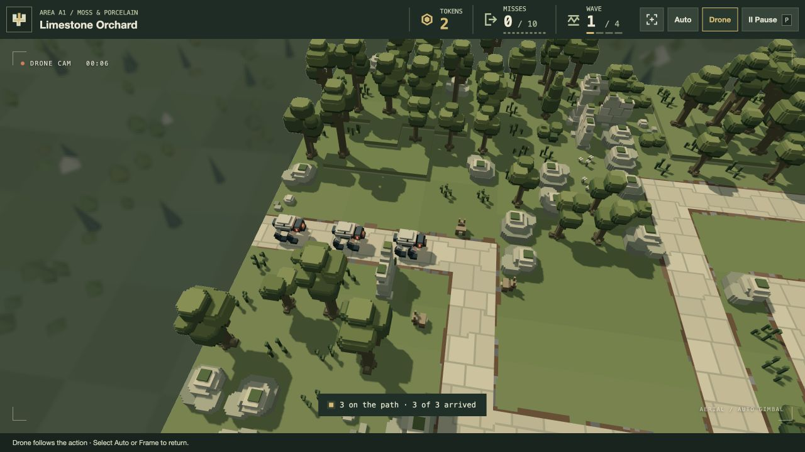

# Camera, lighting, water and combat follow-up

20 October 2026. Implements all eight user notes. **New visual tuning is for user review.** Accepted layouts, arsenal/enemy statistics, token prices, four-wave structure, walking speeds, and the running rollback remain. The Dune Tread model is the explicitly requested asset exception.

| Request | Implemented behaviour |
| --- | --- |
| Camera travel and controls | Default Drone entry and return take 1.05 seconds with smoothstep easing. Eye, attitude and framing interpolate through a general orthographic/perspective projection, with an exact inverse for water/depth effects. Pause freezes it. Same-level preparation returns without a cut; a next-level transfer waits for return before unloading. Completion/defeat can finish the return while combat is frozen. Manual orbit, pan, zoom and movement are disabled in `/play/`; placement picking/keyboard placement and view buttons remain. Preview controls are unchanged. |
| Vista hierarchy | Background linear RGB ×0.76 and the existing nine-tap filter radius doubles from 1.6 to 3.2 half-resolution texels. Only uncovered background pixels sample it. Night/twilight ambient colour also darkens the background; no gameplay depth of field is added. |
| Water variation | Continuous broad patches vary small-wave phase, current direction, calmness, tint and crest glints. Spatial warping breaks the uniform repeating pattern; animation retains its seamless cyclic phase. Actual terrain/water extents, flat geometry, refraction/SSR, fish, splashes and gentler impact ripples remain. |
| Six-wheel enemy | Dune Tread keeps its ID, hull, sensors, ordinary movement and statistics. Removed both continuous track belts/frames; six larger exposed wheels use three joints per side, matched rolling radii, connected fender supports and ground clearance. Regenerated its source/compiled mesh and model-derived portrait. B1 wave2 now says Wheeled procession. |
| Bullet sparks | A separate deterministic surface sampler finds visible points/normals on the actual animated enemy before damage/death. Each successful cosmetic contact emits ten warm-white sparks into the existing bounded shot pool, lasting 0.32 seconds. Damage stays one pulse for paired barrels; no additional hit, explosion or spark light is created. Cosmetic sampling does not consume Arc's RNG. |
| Other defences block LOS | Keep the static terrain/scenery tree. Separate exact occupied cuboids for each defence part follow live rigid matrices, with a conservative sphere rejection before exact local segment tests. Gun, Arc and combat-drone queries exclude only their own unit ID. Arc surface contacts use the same exclusion. Deployment/move/upgrade/removal rebuild the membership. Empty gaps and over-unit shots stay valid; enemies/wildlife remain outside this cover layer. Indirect missiles retain their existing lack of a direct LOS requirement. |
| Missile steering jets | Each seated round receives its own deterministic pseudorandom 0.85–1.15turn-rate factor, retained by launch forecasting. Angular speed ramps up/down at a bounded 40 rad/s², slowing for remaining error. Opposed lateral jets near nose/tail pulse for acceleration and reverse for braking; constant-rate coasting needs no torque. White flame shading preserves their near-white colour. Main boost/attack flames stay warm; terminal engine-off flight stays inertial. |
| Four lighting periods | Every zone repeats level 1 day at 10:30, level 2 late afternoon at 16:30, level 3 early evening at 18:30, level 4 night at 22:00. Warm afternoon/twilight and a restrained blue moon fill keep play readable; these are authored presentation presets, not an astronomical simulation. Conditions stay fixed across waves and preparation, with weather off and no random draw. Runtime clones change; saved levels and `/game/` lighting controls remain authored. Fresh runs restart A1 in day. |

Missile thrust capacity is now 144 rather than 72 instances: **+4,608bytes** each for CPU payload and lazy GPU vertex storage. The 36 light slots and portable local-light ceiling remain unchanged. White steering shapes reuse the existing particle/bloom pipelines. Camera transition scratch/projection settings are reused; normal frames do not allocate transition snapshots. Defence cuboid storage is counted in visibility byte accounting and released with the scene. Water/vista changes introduce no new images or passes.

## Verification

- [135 affected tests across 16 files](tests.log) pass. Coverage includes real camera projection/inverse round trips and reversible easing, paused transitions, bounded surface sparks, dynamic defence cover/self-exclusion/removal, wheel model reproduction/connectivity and complete-route animated ground support, gun/Arc/missile combat and lifecycle, launch forecasting/contact, turning pulses/braking/rate variation, and deterministic time progression. Full suite and complete campaign strategy rebalance not run.
- Final focused follow-ups: [visibility/coordinator/combat](final-regression.log), [lighting and visibility](final-checks.log), and [final white exhaust/resource checks](final-effects.log). These overlap the affected tests above and are not additional distinct tests. The final browser bundle also [builds successfully](build.log).
- [64 GPU scene compositions](gpu-checks.json) cover every level and all four periods through overview/high/low/night views. [25 GPU display checks](bloom-checks.json) preserve water transmission, original warm muzzle/explosion shapes, zero-emission equality, smoke exclusion and the 511th local light; no reported validation errors.
- Fresh ordinary `/play/` verifies [disabled scroll controls](manual-controls.json), [eased entry](transition-entry.json), [eased return](transition-return.json), and [actual preparation after the wave](preparation-return.json). Existing user run not reloaded.
- [Real B1 wave2 GPU combat](combat.json) clears 15 enemies with 0 escapes, 209 gun pulses/209 bullet surface contacts, 262 Arc pulses and 8 missile launches; steering jets were observed. This is one recorded formation, not a guarantee for all formations after the requested cover rule.
- [Steering snapshot](steering-jets.json) captures two opposed near-white exhaust shapes at 620 ms, during angular acceleration; native tests also require braking and varying seated rates. No contact/damage event is added by jets.

Human review remains open for camera pace, water appearance, night brightness, blur and jet timing. Other-defence cover and varied missile steering can change existing combat outcomes; no new full-campaign balance claim is made.
