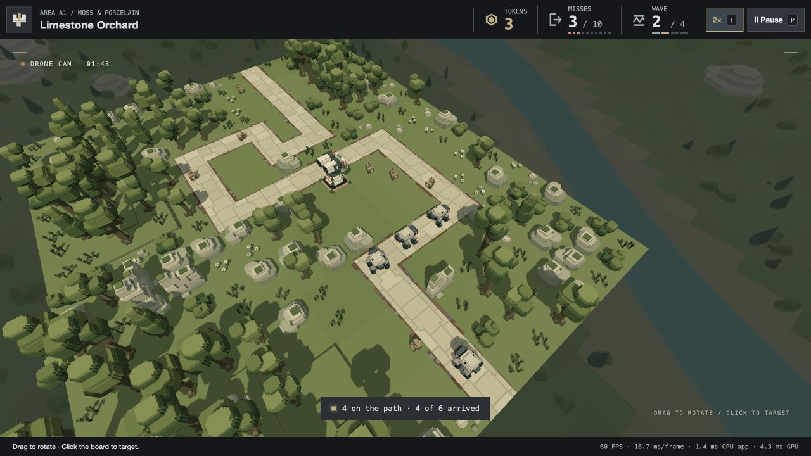

# Player feedback — 23 October 2026

Three separately committed changes:

- Drone: drag either mouse button to rotate. Left-click a board position for a safe offset station, retaining nearby action framing and altitude alternatives. Automatic filming remains until targeting; targets reset between waves/landscapes. Existing 120-unit altitude floor and board/collision rules remain. Sky/outside clicks are ignored; obscured or raised anchors still choose safe destinations. Fixed candidate pools and existing GPU resources are reused.
- Waves: all 16 split-route encounters (A3/B3/B4/C3) begin both ground fronts at time zero; matching airborne trains start together. Counts, identities, profiles and within-route gaps remain. The other 48 encounters are unchanged. Existing independent movement can overlap survivors at A3/B4/C3 merges; no traffic avoidance or additional balance changes were introduced.
- Speed: the 2× toggle and T ease the shared engine clock over 0.6 real seconds. The exact smoothstep integral keeps elapsed simulation time independent of display rate. Pause/visibility resets discard idle time; preparation resets 1×. Performance sampling and paused screenshot navigation use real time.

Verification: 43 focused camera/input/ownership/UI/presentation checks (including native manual clearance at 30/60/120 Hz); 38 wave/config/session/engine/campaign checks (including simultaneous activation of both entrances in every affected encounter); 45 speed/clock/UI/engine/performance/screenshot/inspection/packaging checks. Counts overlap across shared files and are not additive. Review identified and repaired hard visibility rejection for raised/obscured targets and planning against an eased previous focus.

Isolated native A1 browser review exercises real click/drag input, the speed button/T, intermediate scales, exact 2×, paused clock preservation, resume and preparation reset. No reported game errors. The ineffective isolated test gun allowed three escapes; this is an input/lifecycle review, not a balance or campaign-clearance claim. Visual feel and changed merge pressure await player feedback. No measured performance claim.

Local static package refreshed using the existing packager. Packaged validation passes all output/hash/MIME checks at root and repository-prefixed URLs, loads all sixteen levels and starts all sixty-four wave rosters. No active player reload, save modification, push or publication.
