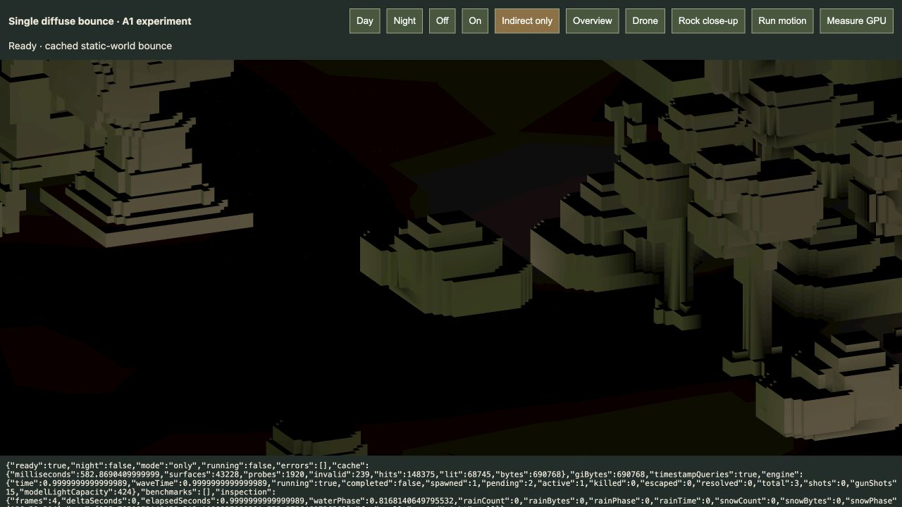

# Grass-to-rock indirect colour audit · 20 October 2026

**Retired lighting experiment:** the user rejected GI and AO on 20 October. All related executable code, viewers, bake/audit scripts, GPU timing machinery and generated GI caches have been removed. The material below records earlier work, not current capability or a pending task. Other deliveries described here retain their separate status.

**The user's expectation is correct:** directly lit green ground can supply green diffuse light to nearby stone in a single indirect bounce. Material information is present. The isolated prototype transports colour, but its current coarse spatial/directional approximation does not reproduce local colour accurately enough to call it a finished GI solution. This audit does not add bounces, change material/lighting tuning or integrate GI into production.

## What was checked

- The terrain and scenery meshes already store **linear RGB diffuse colour** per face. The baker reads this colour at a hit, multiplies it by effective direct sunlight and evaluates a diffuse bounce. The final shader multiplies the received bounce by the rock's own diffuse colour. No material texture or new material field is needed for the requested tint.
- `reflectiveness: 0` disables the existing specular/reflection response; it does **not** disable matte diffuse colour transfer. A new green-floor/vertical-receiver regression confirms this with zero specular reflectiveness.
- The full path is wired into the actual review shader. A frozen GPU close-up confirms that the rock receives greenish illumination in **Indirect only**. That view displays incoming diffuse irradiance divided by pi at review strength 0.55, before receiver albedo; it is a diagnostic, not the final stone appearance.
- Normal rendering retains a relatively strong coloured ambient fill plus warm direct sunlight, warm limestone colours and the muted olive grass palette. The provisional GI multiplier is 0.55. These factors make the added colour shift much less visible than the isolated bounce.

One-bounce colour transport follows the ordinary light transport equation: outgoing diffuse light at the grass becomes incident light at the stone. Extra bounces are needed for further transport, not for this first colour spill. Surface orientation matters: lower sides facing visible ground can receive it; a flat upward rock top cannot directly receive ground below its horizon. [PBRT: the light transport equation](https://pbr-book.org/4ed/Light_Transport_I_Surface_Reflection/The_Light_Transport_Equation), [Filament: diffuse lighting and spherical harmonics](https://google.github.io/filament/main/filament.html).

## Actual A1 numerical comparison

Run `bun scripts/audit-indirect-colour.js` from the project root. [Captured output](audit.log) · [Full data](audit.json).

The audit uses the same A1 day source/cache as the review, all 2,592 vertical low-rock quads and a spatially distributed subset of 32 face centres. It compares the cached lookup with a direct first-bounce reference at 2,048 deterministic sphere directions per reference point, cosine-weighted for the receiving normal and with actual nearest-surface and sun-visibility tests. Like the prototype, reference rays have a 192-unit reach. No recursive bounce or ambient is included.

For the 32 sampled face centres, actual grass supplies about **73% of summed RGB bounce energy**. This is sample-specific, not a campaign-wide fraction. The reference is greener than red on 26 faces. On **four** of these, the rendered probe estimate is instead redder/equal. This is evidence of local approximation error, not evidence that material colour is absent.

A second bake changes **only the in-memory grass source colour** to neutral grey at the same linear luminance. Geometry, sun, other materials and the saved cache/assets stay unchanged. Across the surveyed rock faces, restoring grass chroma decreases red/blue and increases green, demonstrating a real colour contribution from the grass. Source-neutralisation does not mean the stone itself is recoloured.

The saved `vertexAverage` values are the mean of four vertices. `renderedCenter` is the two-diagonal-vertex interpolation at the actual quad centre, matching its triangle split; the latter is used for the four-face hue-error count. Reference and cached values are **linear incoming diffuse irradiance divided by pi**, before rock albedo and review strength. They are not screenshot RGB or perceptual colour measurements.

## Why accuracy is limited

Probe spacing is 24 units, the width of a whole gameplay tile; there are only four spherical-harmonic coefficients per RGB channel, from 192 bake rays. A nearby probe can see a different mix of pale paving, rock and green ground than the particular rock face. Evaluating only at face vertices and interpolating across a face further averages local spill. Invalid-probe rejection and conservative solid visibility can remove useful local samples as well as prevent leaks. Removing those checks is not a valid fix.

Of all surveyed low vertical faces, 120 have zero bounce at all vertices; centre lookups are zero on 401 faces, versus 95 with transfer visibility disabled. These counts alone do not distinguish physically occluded faces from false rejection and must not be read as a count of bugs. The direct reference subset and colour-neutralised bake provide stronger evidence of real colour transport and local mismatch.

The broad ambient fill is an artistic approximation of environmental/indirect light already present in the baseline. Adding the experimental bounce on top can brighten shadows while producing only a small hue change. Final integration should consider replacing some of that fill with resolved indirect light, after comparison and approval of the appearance. This audit does not retune it.

**Proposed next step:** improve static receiving-surface accuracy and probe/visibility sampling, compare against a denser/converged reference, then evaluate ambient/indirect balance. Additional bounces or extra global green gain would not resolve the demonstrated local sampling error. The previous 6–8 ms measured GPU overhead also remains unresolved; no new performance claim is made here.

## Browser proof and scope

The isolated review (removed) now includes **Rock close-up**. Select **Off**, **On** or **Indirect only** to compare the same fixed A1 limestone structure without moving the camera or advancing combat.

[Normal rendering on](rock-on.png) · [Off](rock-off.png) · [Browser diagnostics](browser.json).

All six focused GI tests pass (31 assertions), including the new matte green-floor case; [fresh test output](existing-checks.log). The review browser bundle passes; [build output](build.log). There are no reported GPU errors in the saved review diagnostics. These checks validate the stated bounded cases, not universal GI correctness. No production renderer/shader, accepted material, saved level, gameplay, active player run or cached lighting value was changed. Tool changes are limited to the review close-up control, audit script, focused test and documentation.
