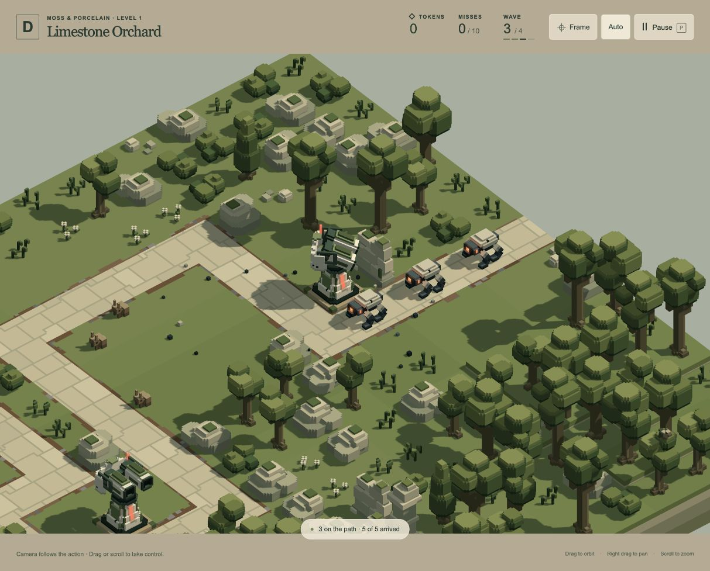
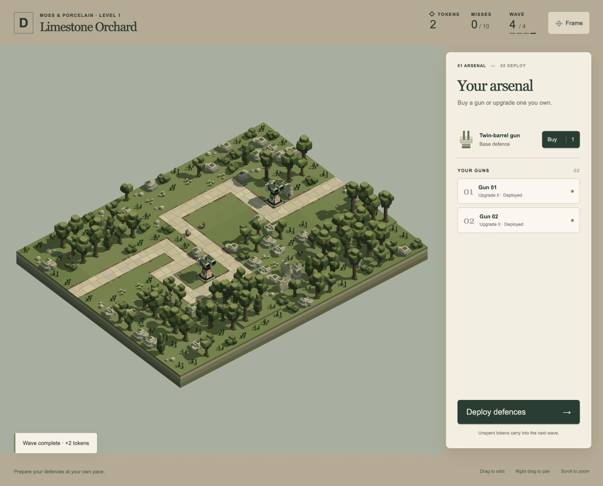

# Confident turret targeting — 19 October 2026

The user reports a turret turning toward an enemy after a kill, then choosing a different enemy on A1 wave 3. The existing browser run exposed Upgrade II guns at `[4,0,9]` and `[12,0,6]`. Replaying those positions through the real engine reproduced the behaviour.

## Cause and correction

The planner's general 0.35-second hold could expire before the gun had completed its turn and previous-shot cooldown. Future damage promised by the other gun, combined with an alternative becoming visible, then caused another target choice. The reported arrangement produced four switches away from eligible targets without firing at them; three occurred after about 0.367 seconds with approximately 40–59 degrees of yaw error remaining.

Stationary gun turrets now retain a new eligible target through cooldown and a bounded acquisition opportunity until their first pulse. The deadline is `max(selection time, weapon ready time) + 0.75 seconds`, using the planner's existing acquisition allowance. The existing valid-burst hold then completes the burst. Dead, removed, blocked, mechanically unreachable and out-of-range targets remain immediately invalid. A lock that cannot produce an actual shot eventually expires so the gun cannot be trapped indefinitely.

After that initial opportunity, normal cooperative coverage, reservations and urgency ranking still apply. This is not an unconditional lock until death. Arc, missile and drone acquisition policies, weapon statistics, wave profiles, models and layouts are unchanged. The planner adds only bounded scalar selection state and a family callback; no recurring allocations, route scans or renderer changes are added.

## Evidence

| Reported A1 wave-3 arrangement | Before | After |
| --- | ---: | ---: |
| Unfired discretionary switches away from an eligible target | 4 | 0 |
| Dogs destroyed / escaped | 5 / 0 | 5 / 0 |
| Actual gun pulses | 50 | 50 |
| Wave resolution time | 29.108 s | 19.675 s |

[Original decision trace](before.json), [fixed decision trace](after.json). These are deterministic combat observations, not a general performance claim or a proof of optimal targeting. Necessary target changes caused by obstruction/range/death remain possible.

Reproduce with:

```sh
bun scripts/play-targeting-audit.js /tmp/targeting-audit.json upgrade2 120
```

The [audit script](../../scripts/play-targeting-audit.js) uses native `PLAY_CONFIG`, actual model/scene geometry, normal planner/aiming, health and wave simulation. It instruments decisions without changing their result. [The regression](../../tests/play-target-commitment.test.js) repeats both Upgrade I and Upgrade II at 30/60/120 Hz, requires all five kills and no eligible-target reconsideration before a first shot, and checks identical outcomes across frame rates.

**105 unique affected tests pass.** No full-suite run was performed.

- [55 targeting, pitch and leading checks](targeting-tests.log), including acquisition/cooldown, the first complete burst, bounded fallback, immediate invalidation, reset/disposal and ordinary shared planning.
- [22 player/camera checks](play-tests.log), including the exact reproduction, all three gun models, complete eight-wave success, ten-miss defeat and real laptop/desktop camera framing.
- [24 passing Arc/drone checks and the initial missile run](mixed-defence-tests.log), followed by [all four missile checks passing](missile-tests-final.log). The initial missile run exposed two stale Zone D fixture counts from before Monowheel removal. Updated only those expectations to the already-approved five enemies, 47 total actor slots and 11 model lights; no D source or runtime behaviour changed.
- Browser bundle succeeds: 79 modules, approximately 0.52 MB.
- [All 85 active asset sources match the prior baseline](preservation.json). No asset or frozen-backup writes were made.

## Browser status

The current user run was read without modification to obtain its actual deployment. Automatic approval review initially blocked reloading the tab because it would discard the run. The user then explicitly approved “Reload and verify the fix”; the existing tab was reloaded and no duplicate tab was created.

Played the first three waves normally: bought two base guns at the reported positions, upgraded both to I after wave 1 and both to II after wave 2. The live third wave matches the deterministic trace exactly: five Dogs destroyed, zero escapes, 50 actual pulses and 19.675 seconds of wave time. The fixed build renders and proceeds through settling/rewards without console warnings or errors. [Browser observations](browser-review.json) record the setup, combat and result; the exact no-dithering assertion comes from the per-decision engine trace, while the browser verifies the integrated build and motion/outcome.

Left the user's existing tab ready for A1 wave 4, with the same two Upgrade II positions, zero cumulative misses and two tokens, matching the progression/wallet observed before the authorised restart. The user can continue from that preparation screen.




