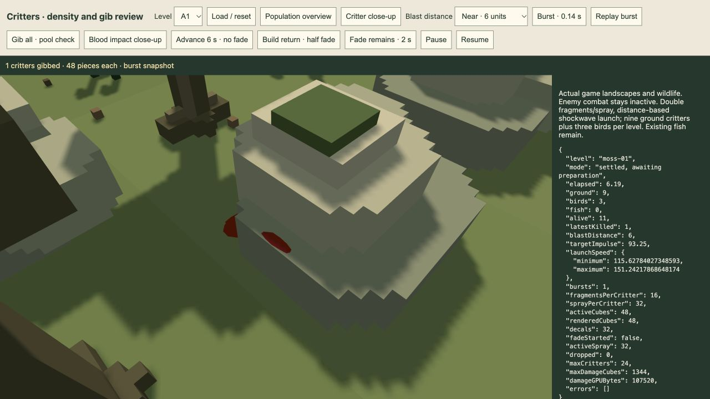
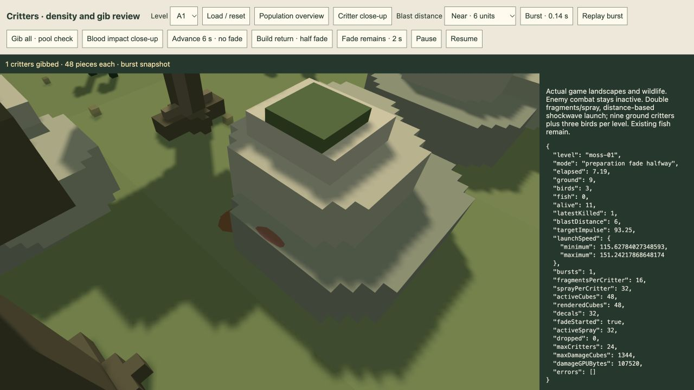

# TODO 28–30 delivered — 21 October 2026

Implemented in the production player and shared effects renderer. Existing user playthroughs were not reloaded; the changes apply on the next application load. New appearances remain for human review. No accepted level/model assets, campaign balance, water settings, skyboxes or lighting presets changed.

## 28 — hidden paused screenshot camera

Pause with P, then press **Backspace**. The complete pause overlay and its background dimming disappear; the Drone viewfinder is hidden. The existing HUD/footer framing stays. **W/S** move forward/backward along the viewing direction, **A/D** strafe and mouse drag rotates. Flight is72world units/s, diagonal-normalized and independent of terrain/board bounds. Looking up/down and moving forward provides vertical flight.

A second **Backspace** restores the original paused camera position, orientation, FOV/projection, roll and overview settings, and restores the pause screen without resuming. **P/Escape** also restore the saved view before ordinary resume. Repeated Backspace key events do not retrigger the toggle; text editing and modifier shortcuts are left alone. Focus/visibility loss clears held movement/dragging; errors, scene switches and teardown release the temporary camera owner. The mode has no advertised gameplay button.

Only the camera advances in this mode. Render calls use zero simulation/render delta and the unchanged engine time; enemies, weapons, wildlife, particles, weather, water phase and the camera director remain frozen. Paused performance readouts remain paused. Idle screenshot frames skip drawing when the camera is unchanged. Existing perspective/overview modes and normal player control restrictions remain.

`play/screenshot-camera.js` owns the temporary camera snapshot; the existing camera provides free-flight input, and the shared player loop runs camera-only frames while paused. No new animation loop is added.

Actual production UI checks in the independent player review verified native Backspace entry/exit and drag rotation. Its test button held each WASD key for0.3seconds through the ordinary DOM keyboard listeners: each moved about21.6units while engine and Drone time stayed fixed. Camera restoration is exact in the captured diagnostic object; unit checks additionally compare the full projection matrix for perspective and overview. [UI/movement evidence](screenshot-mode.json), [screenshot](screenshot-mode.jpg). The screenshot contains review-only diagnostic controls, absent from `/play/`.

## 29 — blood impact marks

Each small red droplet becomes a larger flat blood mark at its first actual swept solid collision. The mark uses an irregular12-triangle fan, matte blood colour and no image texture. Its footprint is nominally about3.0–4.1units across (before irregularity/clipping), larger than the0.28–0.64-unit droplet; narrow supporting faces clip the footprint. The mark follows the contacted normal on all six collider faces, including vertical faces/undersides, with a0.012-unit outward surface offset. It is bounded by the supporting cuboid rather than floating beyond an edge or across a scenery gap.

Collision uses the existing exact static terrain/scenery/bridge cuboids and conservative particle sweep; this does not introduce collisions/attachments to moving actors. Fluid surfaces do not receive a floating mark. A submerged droplet can stain the real bed or underwater scenery, rendered through the existing water path. Each droplet stops as a surface mark instead of continuing as a bouncing liquid cube. Model-colour chunks retain their existing ballistic behaviour.

Conversion reuses the same effect slot and packed20-float instance. Alpha encodes the primitive kind/fade for this debris shader only; opaque emission encoding is unchanged. The camera depth/colour paths draw the same flat primitive and ordered fade mask. Marks receive scene lighting but cast no shadows and add no local light/reflection/bloom source. There is no new draw, pass, buffer, texture or GPU capacity. Reserved capacity remains1,152critter pieces plus192enemy pieces, with a107,520-byte GPU instance buffer. Additional per-slot CPU fields hold the surface normal/extents; packing and collision use reused scratch arrays.

A real A1 burst produced32surface marks and retained48pieces beyond settling, with no drops/GPU errors. A longer exploratory observation retained those48pieces/32marks for over100simulated seconds before any fade call. The full A1 population produced576persistent pieces and125marks after six seconds, also without drops/errors; off-board droplets with no hit remain particles. [Single-impact data](blood-impact.json), [full-pool data](pool-before-fade.json).

## 30 — retain remains until preparation, then fade

Removed the critter-fade calls from wave completion and defeat. Every fragment, droplet and surface mark stays fully opaque during the wave and the entire four-second post-wave settling view, including late missile gibs. **The earliest fade trigger is the actual build/deploy screen return.** The existing fade lasts two seconds.

Same-level preparation rebinds the enemy effects while retaining critter slots and their time, then begins the fade. Critters respawn safely as before. At a level boundary, preparation is displayed over the outgoing board while only the remaining cosmetics fade; transfer controls stay busy and the next landscape loads after that two-second fade completes. No inactive biome/scene is cached. If no critter remains exist, loading proceeds immediately. A very quick next-wave start clears an unfinished old fade to guarantee the fixed slots for new critters. Defeat/final-completion views retain remains until ordinary scene disposal/restart.

`play/critter-lifecycle.js` gates the fade on the session's actual preparation state. The superseded defeat-only cosmetic-fade helper and test were removed. Reset/unload still clear all effects and references. Both full-model fragments and flat blood marks use the same lifetime and coverage fade.

Actual GPU review verified a halfway fade and complete cleanup of the pooled pieces: [halfway pool data](pool-half-fade.json), [finished pool data](after-fade.json). The following image compares the same single-burst wall view halfway through its preparation fade:

An independent production player session also completed an unarmed A1wave and returned to the next build screen without errors: [return state](build-return.json). It was a disposable test run; no balance conclusion is drawn from its three escapes.

## Verification and review

102targeted tests pass across12affected files, including new screenshot, blood collision and session-lifecycle tests. They cover all six contact faces, footprint bounds, persistent rebinding, late settling impacts, same-level/level-boundary preparation triggers, defeat/completion retention, quick-start capacity, exact camera restoration, normalized/free movement and focus clearing; existing renderer, water-impact, wildlife-density, camera, session and engine checks also pass. [Test output](targeted-tests.log). The production player bundle builds with Bun. No full test suite or new campaign-balance claim is made.

The independent review tool loads the exact production player DOM/app at `/tools/play-todo-review.html?inspect`; its movement-check controls are confined to that tool. The existing critter review now has blood close-up, post-wave persistence and preparation-fade controls. It is left open on the landed blood marks. The user's `/play/` session is preserved and will pick up the implementation on its next load.
