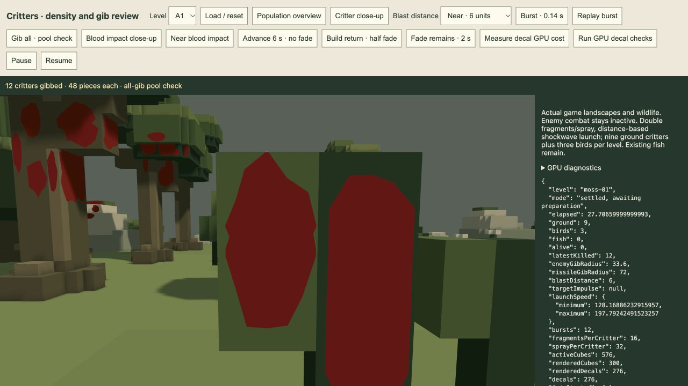
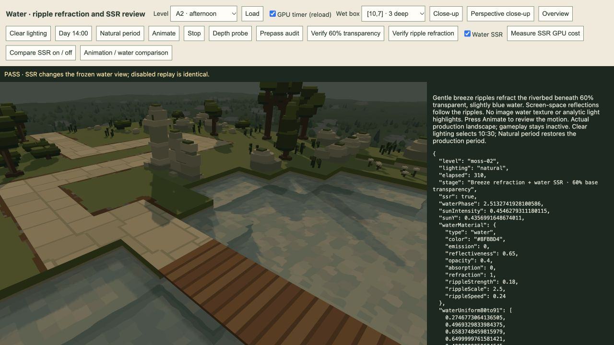

# TODO 31–33 delivery — 21 October 2026

Implemented in the shared production game paths for review. The active `/play/` session was not reloaded; changes apply after the next page load. The two isolated review tools remain available.

## 31 — Smaller enemy-explosion critter radius

`CRITTER_GIB.enemyRadius` changes from 48 to **33.6 world units**, a 30% reduction (two tiles → 1.4 tiles). Missile gib radius stays 72 units/three tiles. Actual enemy-death callbacks already read this shared value, so production requires no duplicate radius override.

Inclusive 3D body-centre admission, burst count, critter population, gravity, collision, preparation-only fade and cosmetic-only gameplay status remain. The same bounded 32–112 units/s impulse curve now uses the reduced enemy radius; its core/edge strengths are unchanged. This changes critter gibbing, not enemy damage or weapon range.

## 32 — Physical blood decal separation

The user reports that the previous per-sample depth-validation revision still flickers near decals. That result supersedes the earlier implementation's visual claim; its report remains historical evidence.

Added a shared **0.08-world-unit outward normal offset** at the actual collision face. Tangential bounds still clip the irregular mark to its supporting face. Marks now use ordinary **less-or-equal, read-only scene depth** and stable alpha drawing order. Removed the per-sample reconstructed-plane comparison, sampled-depth binding and sample-frequency interpolation that could discard fragments near the receiver.

Marks remain outside camera/shadow depth writes, cast no extra shadow, stay matte/lit, use continuous alpha fading and draw last in the existing opaque hardware pass. No additional GPU buffer, texture or render pass; the existing 107,520-byte instance buffer and bounded pools remain. Submerged marks stay below the authored water surfaces. The tiny physical separation may be visible from extreme surface-adjacent positions; attachment remains to static scenery/terrain/bridges, not moving actors.

[32 actual GPU checks](decal-gpu.json) pass, covering coincident coloured marks, both depth-slope signs, near/mid/far perspective distances 3/8/800, angles 0°/75°/87°, occluders in front of the lifted marks, replay stability and opacity/material restoration. All six face offsets and footprint bounds are checked in CPU collision tests. Foreground depth tests now reflect the physical offset; the previous zero-gap receiver-equality tolerance is no longer the contract.

Actual production A1 [pool](critter-pool.json), [half fade](critter-half-fade.json) and [complete cleanup](critter-after-fade.json) checks retain all 576 pieces until the requested fade and then reach zero, with no drops/errors. A new **Near blood impact** review control places the camera three units from the mark; the saved view shows clean, solid marks at close range. Appearance remains for user review.

## 33 — Screen-space reflections on water

All sixteen production water materials and their current authoring default now have **reflectiveness 0.65**. The existing screen-space reflection path is active on upward water surfaces and follows the accepted analytic breeze normals. Reflective weighting increases toward grazing angles (`0.04 + 0.96*(1-cosine)^5`, scaled by the material and hit confidence). This is provisional game presentation tuning.

Retained the blue `#8FBBD4`, opacity 0.4 / 60% base transmission, refraction, ripple strength 0.18, scale 2.5 and speed 0.24. Tint lighting still uses the flat surface normal. No image water texture, analytic sun glint, foam, caustic, sky/environment reflection or extra highlight pass is added. Reflections blend in linear colour after tint/transmission and before display conversion/bloom. The base transmission/tint blend remains affine when reflections are present.

Water reflection rays point above the surface and accept above-water opaque geometry; submerged bed samples are rejected. Screen/clip exits or misses preserve the refracted/tinted water. Existing dry-surface SSR keeps its 40-step settings. Water uses at most**28 steps of 3.5 units**, reaching roughly 100 world units. Marching uses one depth sample per step; only candidate above-water hits validate the nearest foreground across the four antialiasing samples. Edge and distance fades soften lost hits. Existing colour/depth textures and the existing composite are reused: no new production pass, texture, GPU buffer or viewport image.

This is SSR: off-screen, hidden or out-of-range geometry has no reflected image, and thin/occluded surfaces can be missed by the bounded trace. No environment-map fallback or particle/bloom reflection system is implied. The current player's JavaScript modules remain loaded until the user reloads the page.

### GPU comparisons

Frozen-camera, frozen-ripple-phase comparisons using the actual production renderer:

| Scene | Pixels changed with SSR | Largest display-channel change | Disabled replay / zero material strength |
| --- | ---: | ---: | --- |
| [A2 afternoon](a2-ssr.json) |73,437|16|Both exactly match disabled SSR|
| [A3 evening](a3-ssr.json) |29,468|14|Both exactly match disabled SSR|
| [B4 night](b4-ssr.json) |30,074|26|Both exactly match disabled SSR|

All three comparisons pass with no captured errors. Reflection strength zero reproduces the disabled image, proving that the new material parameter gates the effect.

[Transparency check](transparency.json): 808,954 affected A2 pixels match the 60/40 linear endpoint blend with zero failing channels; maximum display-byte error 0.966 within a 2-byte tolerance. [Independent refraction check](refraction.json), with SSR temporarily disabled to isolate transmission: 228,620 pixels move across 1.7 seconds, while both refraction-off and opaque-tint controls remain exactly still. Ordinary review restores SSR afterward.

### Local GPU cost

Exploratory paired GPU timestamps at **1780×1190**, 24 samples per condition after warmup. Only the cached scene's display draw is refreshed; camera, source geometry and ripple phase are fixed. Actual full combat-frame cost was not benchmarked here.

| A2 view | SSR off median | SSR on median | Difference |
| --- | ---: | ---: | ---: |
| [Overview](a2-overview-ssr-cost.json) |0.786ms|1.769ms|0.983ms|
| [Perspective close-up](a2-ssr-cost.json) |2.687ms|8.258ms|5.571ms|

Large visible water areas cost more. These are local observations, not a frame-rate guarantee or an agreed budget. Earlier 40-step experiments are retained in`a2-ssr-cost-before-prefilter.json` and `a2-ssr-cost-40-step.json`; their medians vary substantially with GPU operating conditions, so they are not a controlled speedup claim. The delivered 28-step cap and lazy candidate validation bound work without adding render-target storage.

## Other validation

- [65 targeted tests](targeted-tests.log) pass across blood collision/packing, critter radii/lifetime, preparation gating, ordinary damage/water impacts, water data and renderer resources/order/cache/cleanup. There are 96,729 assertions.
- [All sixteen current authored levels verify](preview-sources.log). Only water reflectiveness changed in their authored data; layouts, models and gameplay progression remain.
- [Production player build](browser-build.log) succeeds: 108 modules, 1.21 MB.
- Reviewed via `/tools/critter-review.html` and `/tools/water-audit.html`; combat stayed inactive there. No active player-run reload or GUI redesign.
