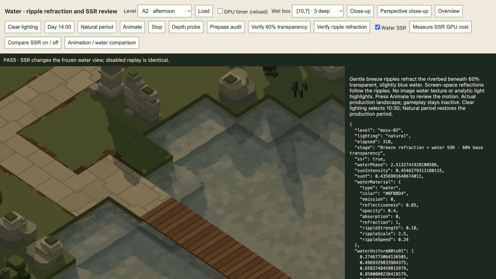
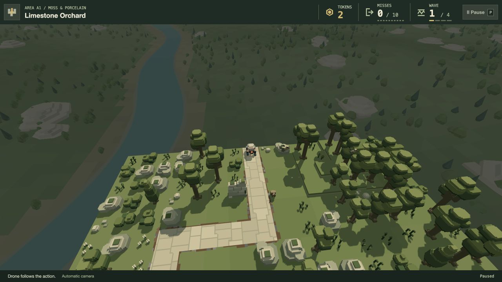

# TODO 34–35 · 21 October 2026

Implemented in the production game for visual review after the user quit their playthrough and authorised the open TODO list.

## Drone opening

`play/drone-camera.js` now searches inside the middle half of each map in X/Z first, rather than around the first enemy/entry point. A small cosmetic seed offset (12% of the shorter map dimension) retains varied openings and repeated entries. Candidate scoring retains view quality; static and live actor clearance remain mandatory. The search widens only if no central candidate is safe; a completely blocked scene declines activation. The cruise height, airborne-lane reservation, later action-driven filming, smooth motion, pause and overview restoration retain their existing behaviour. This search runs on camera entry, with no new recurring storage or simulation work.

## Water reflections

All sixteen current level water materials and the shared authoring default change reflectiveness from 0.65 to 0.85. Water's view-angle reflection weighting changes from `0.04 + 0.96 * (1-NdotV)^5` to `0.25 + 0.75 * (1-NdotV)^5`. The raised floor is deliberate game presentation tuning so reflections remain readable from the high camera; it is not a physical normal-incidence Fresnel value.

The blue tint, 40% opacity / 60% base transmission, IOR 1.333, ripple strength/scale/speed and refraction remain unchanged. Stronger reflection overlays reduce the visible bed contribution where SSR hits, as expected. No image water texture or analytic light glint is added. The existing 28-step trace, depth validation, hit confidence and screen-edge/distance fades are unchanged. There are no additional passes, targets, buffers, textures or ray samples. Hidden/off-screen geometry still cannot reflect; GPU cost was not re-benchmarked for this coefficient-only change.

## Fresh verification

- **55 targeted tests pass**, 289,748 assertions across camera flight/lifecycle, view ownership, paused screenshot camera, water and renderer. Includes 160 opening selections: all 16 production levels, five cosmetic seeds, two entries each, all inside the central half with static/actor clearance. The blocked-centre fallback and completely blocked rejection pass. Existing 30/60/120 Hz flight/combat equivalence, airborne clearance and smooth movement checks pass.
- **All 16 authored sources verify** against their current generator. Production `/play/` bundle builds: 108 modules, 1.21 MB. No full-suite run.
- **Real production `/play/` UI:** fresh A1 entered Drone at approximately `[228,224,228]`, quality 1, with zero blocked moves. Paused after 0.067 seconds and used the existing screenshot mode for the saved composition; the isolated test run was then closed. See [diagnostics](play-opening.json) and [image](drone-opening.png).
- **Actual GPU reflection controls:** A2 afternoon, A3 evening and B4 night each change the visible water when SSR is enabled. Disabled replay and zero reflection strength match SSR-off exactly; no captured GPU errors. [A2](a2-after.json), [A3](a3-after.json), [B4](b4-after.json).
- **A3 paired before/after:** identical frozen phase, camera, source, lighting and viewport; mean absolute whole-image reflection difference rises from 0.004234 to 0.022707 display bytes, about 5.36×. Maximum channel difference rises from 3 to 13. This measures this view's visible contribution, not a universal strength multiplier or increased ray-hit coverage. [Before](a3-before.json), [after](a3-after.json).
- **Base transmission preserved:** with SSR isolated off, 978,866 A2 pixels follow the 60/40 linear-light endpoint blend, zero failed channels (2-byte tolerance, maximum error 0.940). [GPU result](transparency.json).
- **Refraction preserved:** 298,647 A2 pixels change across 1.7 seconds; refraction-off and opaque-tint controls remain exactly still with SSR isolated off. [GPU result](ripples.json).

An initial fallback test fixture placed a tall static box but expected the camera to remain below its top. The existing automatic cruise-height logic correctly cleared it; the fixture was corrected to model an explicit central live-clearance exclusion. The final targeted run is green; no runtime safety relaxation was needed.

Appearance remains for user review. TODOs 34–35 are complete for review; no unchecked items remain. Earlier evidence and historical material values remain in their dated reports.

