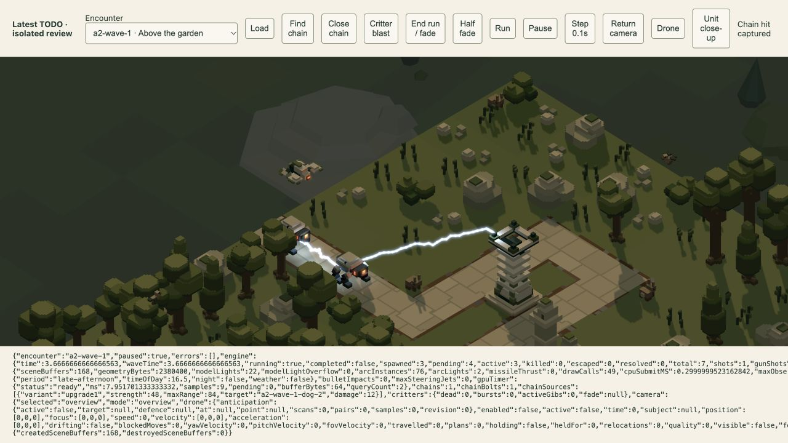
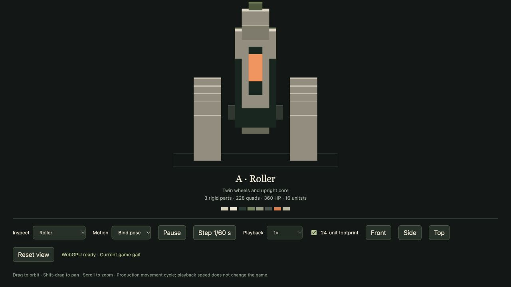
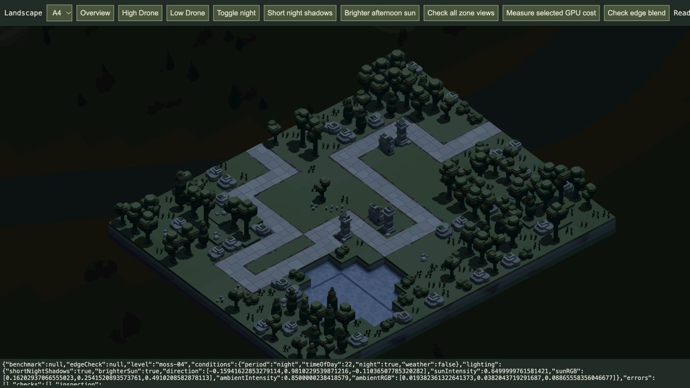

# TODO 36–41 · 21 October 2026

All six requested changes are implemented in the shared production paths for visual review. The existing player tab was not reloaded; load the app again to receive the changes.

## Delivered changes

| TODO | Result |
| --- | --- |
| 36 · Water | Ripple strength 0.18→0.09 in all sixteen current materials and the shared generator default. Retained scale 2.5, speed 0.24, blue tint, 60% base transmission/refraction and reflection tuning. |
| 37 · Enemy aesthetics | Reviewed all ten enemies. Refined six: balanced Dog/Walker/Spider sensor highlights, centred Roller/Tripod sensor strips, removed arbitrary Roller wheel-colour fragments and Twin Fan diagonal guard bumps. Four already coherent designs remain byte-identical. No arbitrary new appendages. |
| 38 · Bloom | Composite strength 0.35→0.70. Selective source extraction, blur footprint, exposure and source masks remain. |
| 39 · Arc chains | Both Upgrade I and II chain once to one random eligible living active enemy within 50% of the originating Arc's range, at 25% of its effective strength. Preserve the existing inclusive 3D torso-distance metric and physical clearance checks. |
| 40 · Night light | Raise nighttime directional Y by 4×, retaining XZ heading, colours, intensity and ambient fill. Flat-ground shadow length becomes one quarter. Evening level-3 light remains at 12°. |
| 41 · Defence obstruction | Missile admission and actual swept flight now include live posed defence solids, excluding the firing launcher. Existing weapon LOS checks already include those parts. |

## Why the combat fixes matter

Old Arc chaining ran only for Upgrade I, at 20% damage and fixed 96-unit range. It also tried to depart from the incoming hit surface; the primary body's own geometry could obstruct a recipient on the other side. New chains sample a departure face facing the recipient and a physically compatible recipient surface, with at most sixteen bounded contact-pair attempts per candidate. Both endpoints follow the current rigid parts, including a lethal primary's final pose. Damage resolves once; visual flicker has no gameplay damage or recursive chaining.

Previously chains competed with primary beams in six slots and could be dropped when all slots were primary. There are now two fixed six-slot banks: primary and secondary. Saturation replaces only the oldest beam within its own bank. Beams retain the existing brief lifetime, lighting and sparks; secondary beams depart directly from the enemy surface rather than using a tower's upward exit bend. Finite pool replacement can still replace older beams during extreme simultaneous saturation; allocation is bounded.

Missile `sceneryContact` traversed only static BVH bounds; live defence cuboids were held separately for LOS. `SceneryVisibility.sweepDefences` now sweeps the existing conservative missile-body sphere through those same occupied cuboids in each part's current rigid transform, preserving openings rather than filling a model AABB. The earliest contact wins against static scenery and the assigned enemy. Contact positions/normals are returned on the actual supporting defence face. Curved powered flight and inertial coast/terminal flight use this path, as does pre-launch admission. Launcher self-exclusion, live matrices and deployment revision invalidation remain explicit. This does not add friendly damage or change missile damage/range/steering.

## Model refinement limits

All ten model sizes, part IDs, parents, pivots and palettes are retained. No occupied cell is added. Geometry is identical except removing sixteen nonfunctional Twin Fan guard cells; other refinements are surface/material changes. Existing walking, wheels, fans, articulated clearance and route tests pass. Dog/Walker/Spider/Roller/Tripod/Twin Fan quad counts fall from 302/372/339/273/304/178 to 301/371/338/228/303/154. Moth, Dune Tread, Ray and Lantern remain byte-identical. Authored sources and their deterministic generators match; the six affected compiled meshes were regenerated.

Spider's formerly split two-cell sensor now forms one contiguous highlight/light cluster, reducing per-Spider light slots from two to one. Updated the player capacity declaration and source-count expectations; no light intensity or range was retuned. The original sources are retained under [before-models](before-models/) for inspection. [Roller before](roller-before.png), [after](roller-after.png).

## Fresh verification

- **145 distinct affected tests pass across 18 files**, including nine real-Arc missile collision cases (three tower tiers ×30/60/120 Hz), launch blocking/ammo preservation/redeployment release, posed LOS/sweeps/openings/self-exclusion, both Arc upgrade tiers, exact boundary/random recipient/single-hop/lethal/airborne cases, endpoint attachment and saturation, renderer/buffer lifecycle, model generation/rig/route/foot clearance, water and lighting. [Summary and method](test-summary.json). Initial failures were old quad/light-count expectations after the deliberate model simplification; revised tests pass. Three early chain tests were corrected by the bounded compatible-contact sampling; final chain checks pass.
- **27 bloom GPU checks pass**, including 731 actual halo pixels with doubled linear-light contribution and zero failures within display quantisation tolerance; nonemitters remain identical and occlusion/water/source masks retain their behaviour. [Readbacks](bloom-gpu.json).
- **34 Arc GPU checks pass**, covering actual pooled ribbon/tube lighting, bloom, depth/water occlusion, near-plane clipping and expiry, with no WebGPU validation errors. [Readbacks](arc-gpu.json).
- **Actual production encounters:** A2 Upgrade I makes a visible secondary beam at 12 damage from strength48/range84 (secondary range42); A4 Upgrade II makes a visible beam at16.25 from strength65/range108 (secondary range54). Both show one primary and one secondary light/channel with no captured errors. [Upgrade I](arc-upgrade1.json), [Upgrade II](arc-upgrade2.json).
- **Four nighttime GPU compositions and old/new comparisons:** actual renderer uniform directions produce a shadow-length ratio of0.2499999974 in A4/B4/C4/D4, preserving identical colour/intensity/ambient values. This is geometric flat-ground projection, not a claim about every stepped/occluded shadow's visible pixel length. [Directions](night-directions.json), [A4 before](night-before.png), [after](night-after.png).
- **Water GPU controls:** A2 reflects with exact disabled replay and zero-strength equality; new ripple strength reaches the renderer as0.09. Isolated refraction changes205,597 pixels over1.7seconds, while refraction-off and opaque-tint controls stay exactly still. The base60/40blend passes978,866pixels with zero failed channels (max error0.950display bytes, tolerance2). [SSR](water-ssr.json), [refraction](water-ripples.json), [transmission](water-transparency.json).
- **All sixteen authored level sources verify** against the current generator. Production bundle builds108modules/1.22MB. [Sources](sources.log), [build](build.log).
- **Retained mixed native campaign clears64waves / 1084 enemies with zero escapes/misses**, including the revised chaining and missile obstruction. This is one legal automated strategy, not human balance acceptance. [Full replay](mixed-campaign.json).

## Resources and remaining limits

Water, bloom and night-light tuning add no render resources or passes. Missile collision adds56bytes of reused CPU contact scratch per pool and bounded live-cuboid query work; no GPU resource/pass. Arc instance capacity grows288→480, allocating23,040vertex-instance bytes and3,664light bytes when active (26,704total, +11,040from the prior bounded pool). When plasma is also active, merged tube storage is8,528bytes (+1,824). The zero-count tube binding remains320bytes. Arc typed arrays total39,644CPUbytes, plus ordinary reference arrays/object overhead. [Measured sizes](resources.json).

These are allocation/work counts. No fresh whole-game performance benchmark or guaranteed frame-rate claim is made. The native replay and renderer/GPU checks establish tested correctness, not every possible player placement, camera view or effect saturation. Model appearance, gentler ripples, stronger bloom and shortened night shadows await user review. GI/AO remain removed. No open TODOs remain after this delivery.

