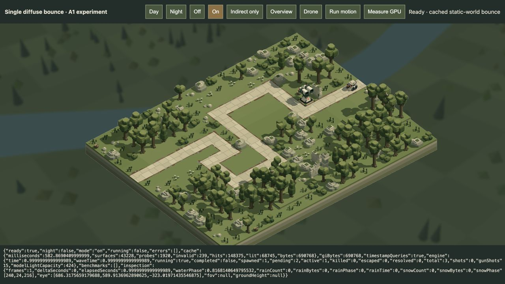
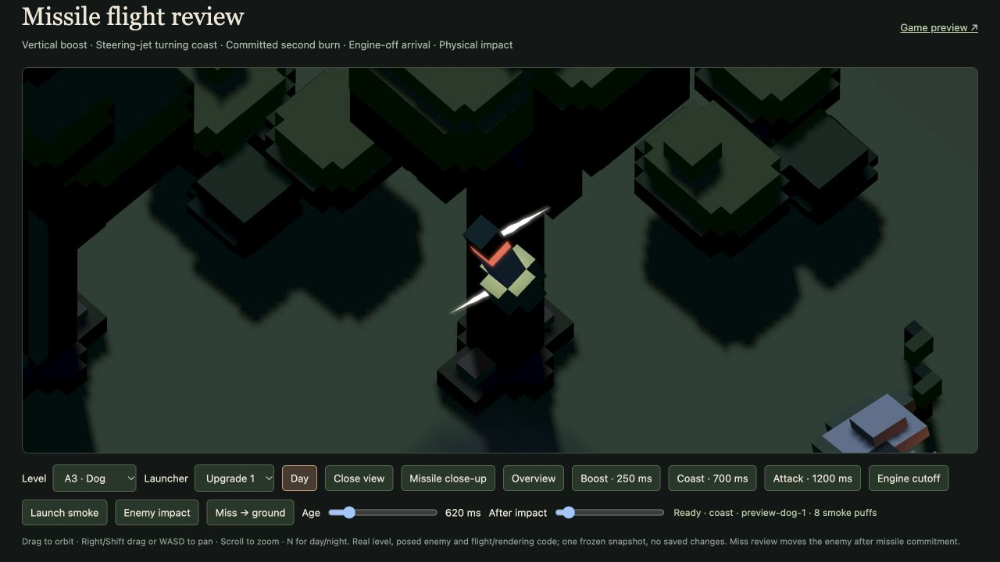

# TODO delivery · 20 October 2026

**Retired lighting experiment:** the user rejected GI and AO on 20 October. All related executable code, viewers, bake/audit scripts, GPU timing machinery and generated GI caches have been removed. The material below records earlier work, not current capability or a pending task. Other deliveries described here retain their separate status.

The three requested TODO items are implemented for review: an **isolated A1 indirect-lighting experiment**, a production Drone transition fix, and shorter illuminated missile steering jets. The lighting experiment is deliberately separate from `/play/` and `/game/`. The user's existing player tab was not reloaded or reset. Numerical gameplay, flight integration, models, level sources and the frozen backup were not changed.

**Subsequent colour audit:** [grass-to-rock validation](../research/indirect-colour-audit-2026-10-20/README.md) confirms diffuse colour transfer but exposes local hue error in the coarse prototype. Its original bounded checks do not establish full GI correctness. No production integration or lighting retuning follows from that audit.

## Single-bounce experiment

The interactive GI review has been removed. Day/Night, Off/On/Indirect only, Overview/Drone and moving-receiver controls compare a fixed scene without changing the production game. Strength is provisionally 0.55; accepted ambient/direct lighting remains unchanged. The experiment is complete; production integration is **not** proposed at the current cost.

The offline baker traces 192 directions at each of 1,920 world-space probes, gathers directly sunlit static terrain/scenery albedo, and stores first-order RGB spherical harmonics. There is exactly one diffuse reflection, with no ambient, emissive, dynamic-light or recursive source feedback. Both day and night caches use effective runtime directional lighting. Actors receive the cached light at their current transformed vertices, but never become baked reflectors or blockers.

Invalid interior probes are rejected (239 in A1). Probe-to-receiver interpolation checks the actual static occupied-cuboid BVH, includes normal weighting and returns zero when no valid visible probe remains. Tests demonstrate red colour transfer, zero energy from black/unlit sources, thin-wall rejection and real openings. Cache fingerprints and length/finite/BVH-escape checks reject stale or malformed buffers before upload. The cache bake script and generated probe/BVH files have since been removed.

The review renderer adds three owned buffers totalling **690,768 bytes**: 122,880 probe bytes, 567,840 visibility bytes and a 48-byte uniform. There is no additional image/pass; the isolated opaque vertex shader evaluates the bounce. Scene replacement destroys/replaces those buffers, and review disposal destroys the buffers/query set. Ordinary renderers do not import the GI shader or allocate its resources. The shared renderer only gains an optional timestamp-query device request, disabled by default.

Actual WebGPU opaque-pass timestamp means, 24 measured frames after four warm-ups per setting, 2560×1124 physical pixels on this host:

| A1 | Off | On | Added opaque GPU time |
| --- | ---: | ---: | ---: |
| Day | 1.786 ms | 7.974 ms | 6.188 ms |
| Night | 1.584 ms | 9.672 ms | 8.088 ms |

These compare the same review shader with zero/nonzero GI strength. They are local samples, not a hardware budget or general frame-rate guarantee. Separate queue-completion and CPU-submit measurements are retained in [day diagnostics](gi-day-browser.json) and [night diagnostics](gi-night-browser.json). Full-frame queue completion includes more work than the opaque timestamps. Visibility traversal dominates this first conservative implementation; precomputed static transfer and cheaper dynamic-receiver visibility need investigation before integration.

**Limits:** coarse probes/first-order harmonics soften directional detail; light is interpolated across each rendered face after per-vertex visibility, so large faces can smear discontinuities. CPU wall tests are not a proof of zero leaks everywhere in the full scene. The finite probe volume/ray reach can omit distant contributions. Dynamic actor/defence occlusion, dynamic weapon bounce, water, smoke, debris and vista GI are outside this experiment. No claim of physically accurate global illumination, universal clearance or a completed production pipeline is made. Moving enemies and the Drone ran in the actual review renderer without reported GPU errors; [motion diagnostics](gi-motion-browser.json) record the run.

[Day off](gi-day-off.png) · [Indirect only](gi-day-only.png) · [Night on](gi-night-on.png)

## Drone transition

The coordinator now captures the independent unblended Drone destination while retaining the displayed source projection for interruption/reversal. Perspective progresses during the hand-off rather than remaining orthographic until the final frame. Lens scale is solved from interpolated apparent size at a moving composition anchor, avoiding the retreat caused by combining a synthetic 900-unit overview eye with a linear lens blend. Orientation follows that anchor during translation, retaining endpoint gimbal offsets; simply interpolating Euler angles had pointed away from the battlefield midway through B4.

Travel remains eased over 1.05 seconds in both directions. The existing higher/farther stations, varied starts, predictive filming, smooth motion, pause and disabled manual controls are preserved. Rapid reversal starts from the displayed pose. No camera collision, combat or defence behaviour is changed.

[Production CPU replay](camera-replay.json) covers A1/B4 at 30/60/120 Hz and aspect ratios 0.8/1.5/2.4. All 18 replays keep the moving composition anchor within the central half of the image and keep the completion marker scale jump below 4%, replacing the historical 3.56–4.15× switch. The marker is a fixed 12-unit segment at the initial subject, not a promise of identical framing for moving combat. Regression tests exercise repeated wave/preparation entries, interruption, pause, exact endpoints and invertible matrices. Existing Drone tests cover same-level actor rebinding, fresh openings, real A1–A4 motion and unchanged combat. Browser checks use the isolated campaign viewer, including an interrupted A1→B4 transfer, with actual production lighting/controllers.

[Mid-transition A1](camera-a1-mid.png) · [Mid-transition B4](camera-b4-mid.png). The campaign viewer now has explicit 0.1-second stepping and return-camera controls for repeatable review; these are not player controls.

## Missile attitude jets

Directional jets are **5.25 units**, exactly half the previous 10.5. Opposed white nose/tail couples retain their acceleration/braking direction, cadence and per-missile 0.85–1.15 turn-rate variation. A purely visual post-turn angular-error field suppresses the jets and their white contribution at **one degree or less** from the current intended heading. Terminal cutoff and a passed aim also suppress them. Flight direction, speed, acceleration, contact, damage, smoke and main-engine flame remain unchanged.

During unpowered coast, an active couple emits a white point approximation at the missile centre, radius16/strength2.2. During the powered attack, its white energy is merged into the existing engine-light record using strength-weighted colour/position; this bounded approximation does not represent two separately shadowed nozzles. Once steering stops, the exact ordinary warm engine light remains. The main flame/core instances are unchanged and retain their order. This keeps the existing maximum **36 point records /144 thrust instances**, with no shader, pass, light-buffer or uniform-capacity increase. Existing point lights illuminate nearby opaque surfaces and smoke; they remain unshadowed.

Tests cover slow/fast actual turns, residual aligned corrections, on/off cadence, opposite couples, unchanged engine instances, reset and all36 simultaneous active missiles. The actual A3 night review reports length5.25, one white light radius16/strength2.2, no GPU errors and no model-light overflow. Light appearance remains provisional for user review.

## Verification and audio follow-up

- 90 distinct affected native tests pass, including five GI tests; see [affected camera/flight checks](affected-tests.log), [broader regressions](regression-tests.log), [GI checks](gi-tests.log).
- [25 actual WebGPU checks](bloom-gpu.json) pass, including full shader compilation, water/smoke response and the portable511-light boundary.
- [Browser bundle](build.log) passes for production play and the GI review. The existing missile review uses server-root imports and is verified directly in the browser, rather than through the bundler.
- [Input hashes](source-preservation.json) confirm all 86 audited asset sources are unchanged; among 93 audited inputs, only the intended optional renderer timing hook changed.
- A1/B4 camera and A3 missile browser diagnostics/screen captures are retained here. Isolated review tabs were used throughout.

The requested researcher also completed [audio workflow research](../research/audio-workflow-2026-10-20/README.md): a compact internal recipe/sample workbench plus Web Audio is suitable for initial effects, with a proposed offline Ogg Opus encoder and lossless masters. Ogg reduces delivery size but does not guarantee an audible seamless loop or reduce decoded PCM memory. No editor, audio subsystem, sample, package installation or encoder was added. The research records current host tool availability and primary technical sources; final encoded-loop/listening/performance checks remain future implementation work.
