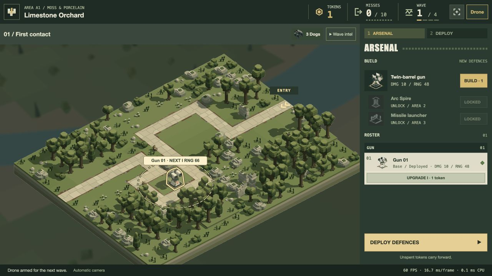
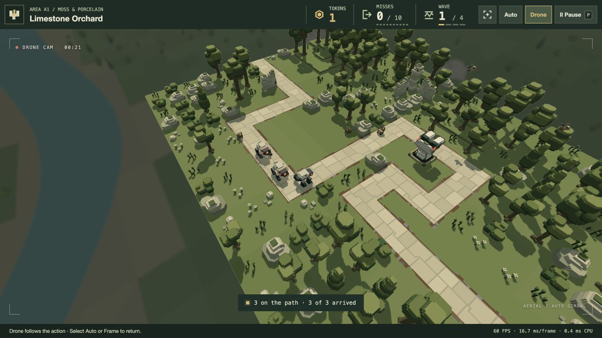
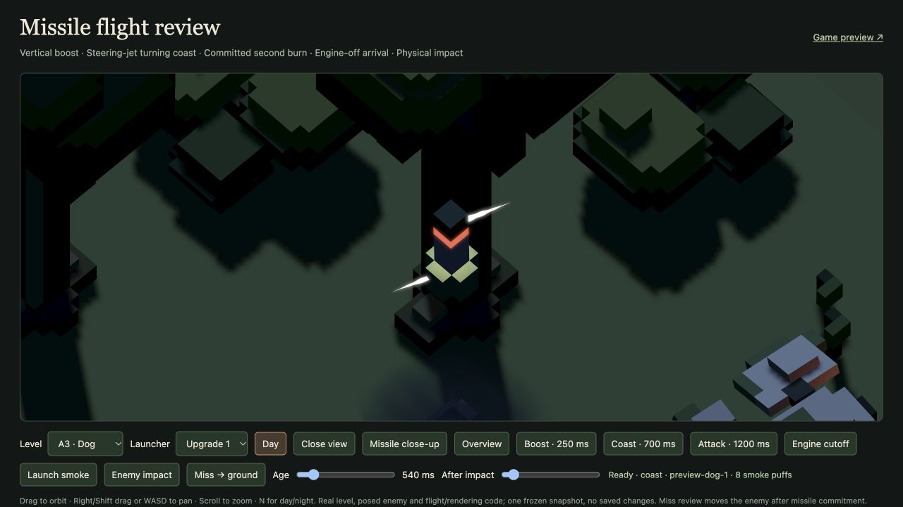
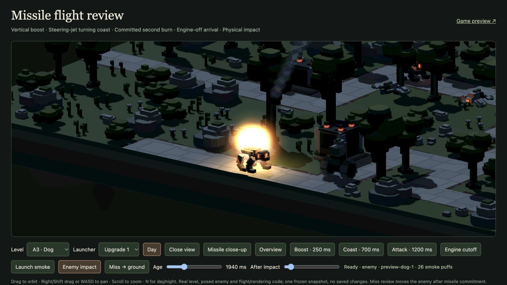

# Player TODO follow-up — 20 October 2026

**Retired lighting experiment:** the user rejected GI and AO on 20 October. All related executable code, viewers, bake/audit scripts, GPU timing machinery and generated GI caches have been removed. The material below records earlier work, not current capability or a pending task. Other deliveries described here retain their separate status.

Implemented for human review: remaining TODO items 3–5 and 7–13. Item 6 stays withdrawn; the original camera-transition fix is superseded by complete removal. The isolated indirect-lighting experiment remains outside production. The user authorised reloading/closing the playthrough and other tabs; all review tabs are now closed. No installation, saved model/level edit or Unreal migration was performed.

## Delivered behaviour

- **Immediate cameras:** deleted the timed overview↔Drone hand-off and its module, mixed projection/depth/vista branches, transition state and level-transfer waiting. Ordinary smooth Drone movement, default combat view, disabled manual controls and four-second effect settling remain. [Camera implementation and endpoint checks](camera-rollback.md).
- **Performance footer:** rolling FPS, wall milliseconds per frame and synchronous CPU renderer time, explicitly labelled. The readings update at most four times per second, reuse bounded storage and reset on pause/loading/hidden/resume. CPU render work is not asynchronous GPU duration. [Browser sample](play-browser.json), [tests](../../tests/play-performance.test.js).
- **Roster and ranges:** stable Gun / Arc Spire / Missile launcher groups retain owned identities and control nodes. Deployed row hover/focus shows actual current horizontal XZ range; UPGRADE shows the next enabled tier with a dashed ring and NEXT label. Pause, scene changes and leaving clear the overlay. No purchase or selection is performed by a preview. [Behaviour and regression details](roster-review.md).
- **Missile attitude:** angular acceleration limit is 16 rad/s² instead of 40, with a gentler proportional settling tail (gain 6 instead of 10). The same guidance function drives actual flight and scenery admission. Per-round turn-rate variation remains. Instead of recurring correction pulses, each flight has one spin-up and one braking impulse of at most 65 ms each. Their white light ends with the 5.25-unit jets; one-degree, passed-aim and terminal cutoffs remain. Main engine exhaust is separate.
- **Impact/light tuning:** removed eighteen outward ballistic missile fragments and their unused shader branches; retain core, eight lobes, smoke, pressure ring and original missile light. Turret muzzle-light peak is 8 instead of 10; all ten enemy-family destruction lights last .336 instead of .48 seconds with peak 44 retained. Other particle durations are unchanged. [Exact settings and bounds](effects-note.md).
- **A–D vistas:** finer terrain facets, composed vegetation groups and biome-specific landmarks. Darkness/softness, sharp battlefield, background-only ownership and existing passes remain. Every immutable geometry buffer is smaller than before and below 4 MiB. [Measurements and detail](vista-notes.md).

## Verification and limits

**181 distinct affected tests pass across 20 files**: [131 integration tests](integration-tests.log), [44 camera/polish/water tests](camera-water-integration-tests.log) and [six indirect-study regressions](indirect-regression-tests.log). No full repository suite was run. The browser build bundles 104 modules successfully. A focused source/CPU integration review found no actionable blocker; the reviewer authored the roster/range code, so that portion is self-review.

**89 actual GPU checks pass:** [64 vista compositions](vista-gpu.json) across sixteen levels in overview/high/low/night, plus [25 shader/bloom/capacity checks](bloom-gpu.json). These include production particle/depth compilation, smoke/water prefixes, local-light capacity and no WebGPU validation errors. They are correctness checks, not GPU frame-time measurements. Geometry generation/storage measurements are in the vista note; no FPS improvement is claimed.

The [actual mixed campaign replay](campaign-mixed.json) completes 64 waves, killing all 1,084 scheduled enemies with zero escapes, a persistent affordable wallet and real placement/LOS/missile collisions. Guidance easing necessarily changes flight trajectories; this replay establishes that the retained strategy still works, not universal balance equivalence. Damage, cooldowns, ranges, prices, waves and authored routes were not retuned. [Audit console log](campaign-mixed.log).

[Before](missile-before.json) / [after](missile-after.json) actual launch traces cover .85/1/1.15 turn factors and 30/60/120-Hz outer updates. Sampled visible attitude firing drops from .27–.33 seconds to .067–.117 seconds; the final visible jet moves from missile age 1.27–1.37 to .93–.96 seconds. Every sample hits without scenery collision. Timing varies with the shot geometry; these are representative traces rather than a universal alignment deadline. Reproduce with `bun scripts/audit-missile-attitude.js OUTPUT.json`; CPU tests also cover death, commitment, inertial cutoff, forecasts, real hits/misses and pool reset.

Live `/play/` checks exercised purchase/deployment, current range 48 versus next range 66, immediate wave-start Drone and Frame/Drone switches, pause freezing identical pose/time, range clearing in combat and resumed timing. The footer reported approximately 60 FPS / 16.7 ms per frame on this run; this is not a comparative benchmark. Browser focus exercised the range previews; pointer hover has targeted event-handler regressions. Missile close-ups show a lit coast impulse, no attitude jets at 1.2-second attack, and nine fireball particles after actual enemy contact. All tabs were closed after evidence capture.

[Source preservation](asset-preservation.json): all 86 model/level JSON hashes match the pre-implementation research inventory. No world collision or navigation data is added by vistas. The damage particle budget drops to 756 records / 36,288 GPU particle bytes; combined cube/particle allocation is 51,648 bytes, saving 3,456 bytes each in CPU and GPU payloads.

## Visual evidence

[A vista](vista-A.png) · [B vista](vista-B.png) · [C vista](vista-C.png) · [D vista](vista-D.png).

The revised appearances are implemented for review, not declared human-approved. Production GI still needs optimisation and improved local accuracy. [Unreal/MCP research](../research/unreal-feasibility-2026-10-20/README.md) is a separate feasibility result; it does not authorise a migration.
