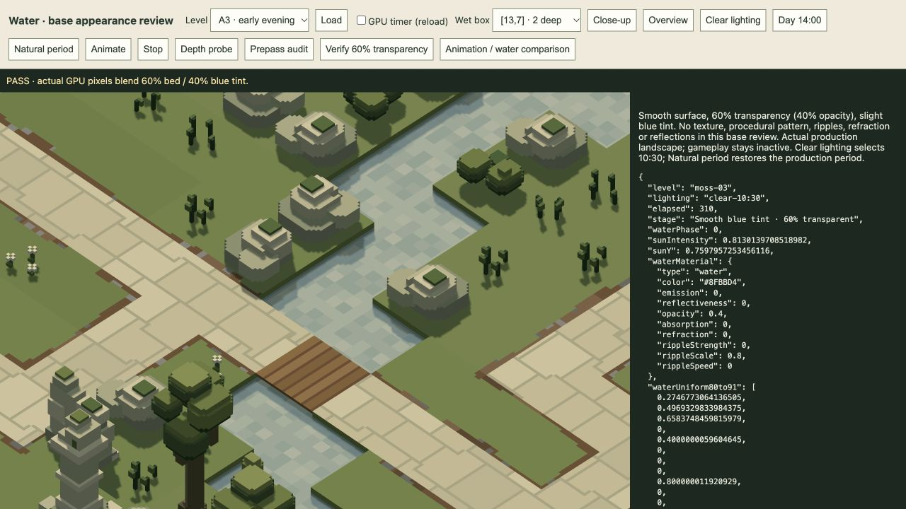

# Water base rebuild · 21 October 2026

Implemented for visual review. The user requests rebuilding water from scratch, starting with 60% transparency and a slight blue tint, explicitly without texturing. Ripples and refraction wait until this base is reviewed.

The new `shadeWater` is a single smooth layer: `0.6 × visible bed + 0.4 × lit blue tint`, blended in linear light before the existing sRGB display transform. The tint is `#8FBBD4`. Ambient, sun/shadows and existing local lights shade it. The previous water-specific procedural variation, ripple normals, crest glints, dusk sheen, Fresnel/SSR reflection, depth absorption and refracted samples are removed from this shader. Existing riverbed colour variation is visible through the water; it is underlying terrain, not a water texture.

Updated shared defaults, only the water-material objects in the sixteen production sources, and `currentPreviewFor()` so regenerating current sources applies the reviewed stage instead of restoring archived materials. Historical/frozen files, models, geometry, combat, cameras, debris-impact effects and opaque SSR remain intact. No new render targets, texture assets or render passes were added. The old material fields remain validated/serializable for compatibility; effects other than tint/opacity are currently inactive in water shading.

[Open the isolated production-water preview](http://127.0.0.1:4173/tools/water-audit.html). It loads real play landscapes without starting simulation. It is left on an A3 daylight close-up for colour/transparency review; Natural period restores dusk. No active player session was reloaded.

Verification completed this session:

- 39 targeted tests pass: `tests/water.test.js`, `tests/renderer.test.js`, `tests/world.test.js`. [Water/renderer log](water-renderer-tests.log). The first world run identified the archived material mismatch; updating the current authoring entry point resolved it, with all 8 world tests then passing.
- `bun run check:previews` verifies all 16 current level sources against their authoring factories, including reference/model validation.
- Actual GPU display captures at opacity 0, 1 and 0.4 verify the linear-light mixture against independently reconstructed endpoints. All changed pixels pass within 2 display-byte values; observed maximum error is below 1.0. This is an image correctness check, not a performance benchmark.

| View | Checked pixels | Maximum byte error | Result |
| --- | ---: | ---: | --- |
| [A3 dusk](a3-dusk-gpu.json) | 315,358 | 0.894 | Pass |
| [A3 daylight](a3-day-gpu.json) | 315,358 | 0.935 | Pass |
| [A2 afternoon](a2-afternoon-gpu.json) | 978,866 | 0.939 | Pass |
| [A2 ten-unit-deep daylight pool](a2-deep-day-gpu.json) | 1,261,648 | 0.972 | Pass |
| [A4 night](a4-night-gpu.json) | 609,173 | 0.933 | Pass |

The [fixed-camera A3 water-time comparison](a3-static-gpu.json) has zero changed pixels after 1.7 seconds; disabling water changes 315,358 pixels. Depth readback confirms the visible water surface lies in front of the submerged bed, and recorded renderer errors are empty.

This is the base appearance stage. Realistic ripple/refraction work is deliberately deferred to the user's next review. The base appearance is not yet accepted.
