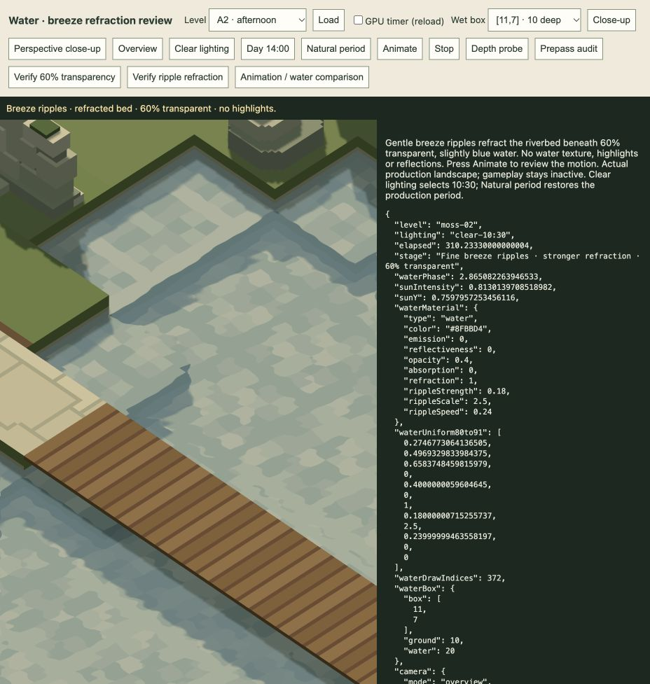

# Gentle breeze water · 21 October 2026

**Accepted for now:** the user approves the finer tuning and requests no further work. Already integrated through the production renderer and all sixteen playable levels; a read-only check of `composePlayLevel()` confirms the material is retained. No additional runtime change or session reload. Earlier pending-review statements below are historical.

## Current tuning after user review

The first pass below is historical. The user finds its ripples too broad and the refraction too subtle for gameplay. Current settings are **5.6/3.2/2-unit wavelengths** (60% shorter), **0.18 slope strength** (2.25×), and **0.24 primary cycles/s**. Blue tint, 60% transmission, no highlights and all shoreline guards remain.

Fresh [12 water/world tests](retuning-tests.log) and [16 authoring checks](retuning-authoring.log) pass. The [matching A2 temporal GPU comparison](fine-ripples-motion.json) changes 351,882 pixels versus the original 194,326; mean absolute RGB difference is 0.936 versus 0.366 display-byte values. Both refraction-off and opaque-water controls still have zero changed pixels. These compare the same scene/camera, lighting, t=310 and t+1.7; visual acceptance remains for the user. No performance claim is made.

## First breeze pass (superseded tuning)

Implemented for review following the smooth blue base. The user authorises slight breeze ripples refracting light, with no highlights yet.

Three small analytic wave slopes bend the transmitted view of the riverbed. Primary wavelength is 14 units, with weaker 8/5-unit components; strength is 0.08 and the primary phase runs at 0.16 cycles/s. The same shared-clock phase drives all current levels. The blue tint (`#8FBBD4`) and 60% transparency remain unchanged.

The rippled normal affects refraction only. Flat-normal tint lighting stays still, with no highlights, glints, reflections, absorption or caustic patterns. Surface geometry stays flat, and no water texture/noise asset is added. Actual water-depth/normal images remain rendering data.

Refraction bends the view ray with a water index of 1.333, projects to a bounded estimate of the bed plane, and validates all four bilinear taps. Samples containing dry banks, bridge decks, sky, other-height pools or off-screen content fall back to the original scene. This is a screen-space approximation; it cannot recover hidden underwater scenery.

Updated the shared defaults and only water-material objects in all sixteen current levels. The current authoring entry point automatically retains them; archives/models/terrain/gameplay stay intact. No production passes, render targets, buffers or simulation systems are added. Extra shader work is bounded; no GPU performance improvement or budget claim is made.

Fresh verification:

- [39 targeted water/renderer/world tests pass](targeted-tests.log).
- [All sixteen authoring source checks pass](authoring-checks.log).
- Actual GPU temporal comparisons at t and t+1.7 show refraction moving in [A3 shallow daylight overview](a3-day-motion.json), [A3 perspective](a3-perspective-motion.json) and [A2 ten-unit pools](a2-deep-motion.json). Each view has exactly zero changed pixels with refraction disabled and exactly zero changed pixels at full opacity, confirming no moving tint/highlight contribution.
- [A3 transparency check](a3-day-transparency.json) still passes: 507,638 endpoint-different pixels satisfy the 60% transmitted / 40% tint blend, within two display-byte values; maximum observed error is 0.952. GPU error lists are empty.

[Open the review](http://127.0.0.1:4173/tools/water-audit.html). It uses production landscapes without starting gameplay. The existing review tab is left animating; no active player session is reloaded. Base and historical static-time evidence remain in the [previous review](../water-base-2026-10-21/README.md).

Appearance and motion remain for user review. Highlights are not part of this stage.
