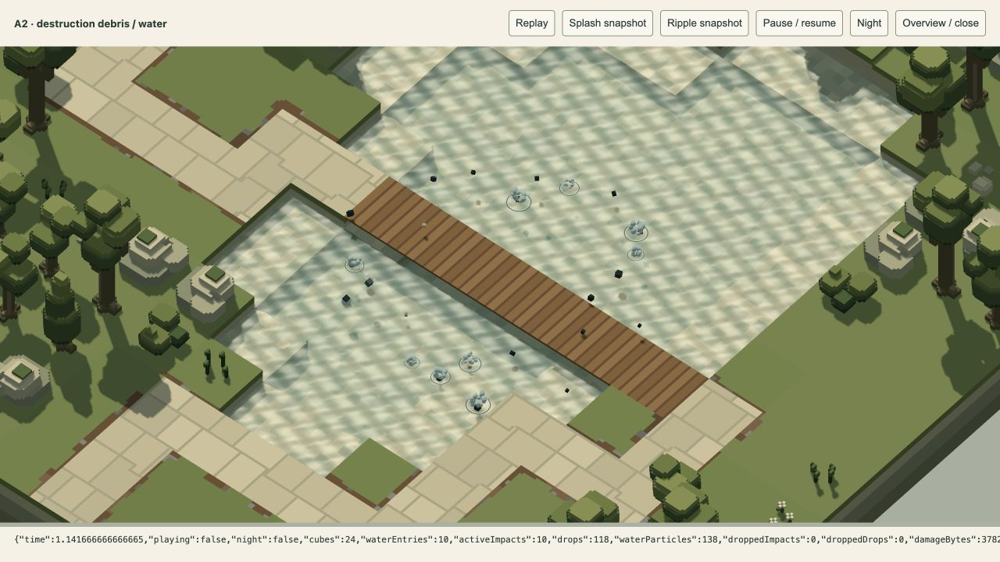

# Heavy debris water impacts — 20 October 2026

The user requests water splashes and ripples when destroyed enemy parts land in A2's pool, with visible weight. Implemented for visual review in the shared production damage effects. The user's in-progress `/play/` tab was preserved; a new page load picks up the changed modules.

## Result

Downward debris sweeps detect the actual authored water surface before solid contact. The first crossing produces a short crown, large ballistic droplets and two expanding rings. Splash power scales with fragment size and fall speed. Droplets have a brief upward impulse, strong gravity and drag; they disappear when they return to water or strike scenery. Fragments lose linear/angular momentum and sink toward the bed. A bridge, bank or prop reached first retains ordinary solid collision.

Water particles receive existing scene lighting, shadows and local lights, with opaque occlusion and no emissive floor. Rings clip to the matching visible water height and use a dark trough/pale crest to remain readable against A2's bright reflections. Night uses the same lighting response. Gameplay, wave profiles, weapon/enemy values, token rules and all 85 asset sources are unchanged.

## Review

Open `/tools/water-impact-review.html` on the development server. **Replay** destroys a real Dog on A2's authored bridge and runs ordinary debris physics; it does not script splash locations. **Splash snapshot** and **Ripple snapshot** freeze reproducible ages after the first actual water crossing. **Pause / resume**, **Night** and **Overview / close** support inspection. These controls are developer-only and do not change saved conditions or player settings.

The default splash snapshot has 10 water entries, 118 active droplets and 138 water particles. The later ripple snapshot has 21 entries and 21 active disturbances. Some requested droplets are dropped at the fixed pool cap during the full destruction, while all 21 surface entries receive their crown/rings. The full replay returns to zero cubes, disturbances, droplets and water records at 5.45 seconds and one cached display draw. Scene buffers remain at 162. [Lifecycle](lifecycle.json), [night capture](night.png).

## Verification

- **52 affected tests pass, 93,449 assertions**: surface queries, wet/dry/upward crossings, bridge precedence, one impact per fragment, sinking, ballistic apex/descent, finite lifetime, 30/60/120 Hz and long-frame handling, pause/reset/reference release, bounded exhaustion, existing damage/water/missile regressions and renderer ordering/resource cleanup. [Log](affected-tests.log).
- **24 numeric production GPU checks pass**, including droplets, crown, matching-plane ripple, dry/unrelated-height rejection, open ring centre, depth occlusion and absence of emission. Existing smoke/blast/cube lighting checks also pass. No WebGPU validation errors. [Results](gpu-check.json).
- Production A2 replay and day/night snapshots show the requested effects. Browser warning/error logs are empty. The review tab is separate from the user's game.
- `bun build play/app.js tools/water-impact-review.js --target browser --outdir /tmp/defender-water-build` passes (92 modules). The GPU checker uses server-root imports and runs directly in the browser.
- All **85 asset SHA-256 hashes** match the preceding Zone A delivery; accepted layouts, models and frozen backup were not edited. [Preservation](preservation.json).

No full test suite was run.

## Bounds and limitations

Pools cap active disturbances at 48 and droplets at 192, with overflow counters. At most 336 additional 48-byte particle records extend the existing shared vertex buffer. Debris/particle GPU storage is 37,824 bytes, up 16,128; the enlarged shared capacity also applies when ordinary damage first allocates that buffer in a dry scene. Water CPU pools are created only for wet worlds. No new render pass, target, light or bloom source is introduced, and inactive water adds no draws or uploads.

This is a cosmetic approximation: fragments remain the existing cubes with swept collision envelopes; the crown is a camera-facing procedural sheet and rings are surface overlays. There is no fluid solver, persistent foam, shore reflection of waves, secondary splash recursion or water gameplay. Final visual heft remains provisional pending user review.
