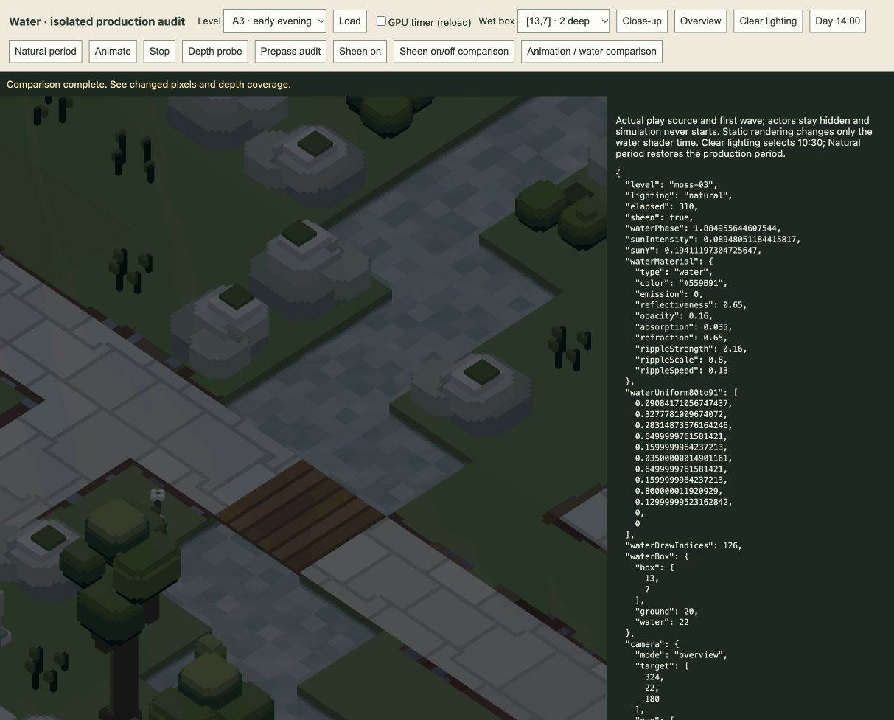

# Water revision and TODO20–23 — 20 October 2026

Implemented for user review. The active player run was preserved. The user rejected the first stronger water sheen; the final shader reduces that added contribution by **75%**, while retaining refraction, translucent bed colour and moving ripples.

## Water findings and final change

The preceding TODO delivery had not changed the water shader, material, terrain, world or bloom sources. The reported A3 scene was rendering water in front of the bed, and its animation phase was advancing. Its stream is only two units deep, with flat four-unit bed colour patches. Ripple refraction often samples the same patch; dusk's low direct sunlight also makes moving highlights much less visible. No missing surface, frozen phase or refraction solver failure was found.

The final change is confined to `engine/shaders.js`: existing moving ripples receive a small ambient-sky reflection when flat-surface sunlight is low. The coefficient is **.07**, reduced from the rejected **.28** candidate. With the existing default material, its maximum ambient mix is **4.55%**. The gate is zero in strong sunlight. No material values, IOR1.333 refraction, transmission, water current, emission or lighting sources were changed; no pass, buffer or texture was added. This is restrained reflection tuning, not a rewritten refraction model.

Actual GPU texture readbacks compare fixed camera images at water times310 and311.7 seconds. The camera and scene remain static; only water phase changes. These are full-frame RGB differences, not frame timings or a universal realism measure.

| A3 dusk comparison | Original | Final reduced sheen |
| --- | ---: | ---: |
| Mean absolute RGB difference, 0–255 scale | .13912 | .25248 |
| Pixels changed by water animation | 362,874 | 516,403 |
| Image fraction changed | 12.94% | 18.41% |

The final dusk animation contrast is about1.81× the original. Water occupies20.82% of this close-up. The sampled wet centre has water depth.40908 in front of opaque bed depth.41045, with valid normal alpha1. The bed remains visible. At14:00 the added reflection on/off comparison differs in only two of2.8million pixels, by at most one channel step; visually unchanged, not byte-identical. A4 night retains clear animation (27.62% of the image changes between phases). All recorded cases have empty renderer-error arrays.

[Final A3 GPU result](a3-final-reduced.json) · [Day comparison](a3-final-day.json) · [Night comparison](a4-final-night.json) · [Original dusk](a3-natural-before.json) · [Original day](a3-day-before.json). `a3-natural-after` records the rejected stronger candidate, not the final appearance. The initial discarded-canvas capture approach was replaced by owned GPU texture readbacks and is not used as evidence.

## Completed TODOs

**20 — ordinary enemy movement.** Removed the half-health slowdown/catch-up helper, wounded-only state/traffic hooks and review button. Original route speed, yaw, gait and aim expressions are restored regardless of health. Existing physical missile-hit impact reactions remain. Two new checks compare all ten species at100%,50% and10% health through16seconds of route bends, aim and rig poses, plus queued damage and impact recovery. The escape-running rollback remains intact.

**21 — camera selectors hidden.** Removed Frame, Auto and Drone buttons, their UI phase actions/click handlers and obsolete hints. Drone remains the run default. Title/preparation overview, immediate view changes and pause remain. A separate actual `/play/?inspect` run verified title, loadout, deploy, wave and pause; the selector count is zero, Drone is enabled/active during the wave, manual controls are disabled and errors are empty. [Browser evidence](drone-ui.json), [capture](drone-ui.png).

**22 — depth prepass confirmed.** Recorded actual production `beginRenderPass` descriptors rather than mock calls. `Initial camera depth` has zero colour attachments, clears/writes/stores camera depth and precedes `Visible opaque surfaces`, which reads that depth. Opaque scene instances and active debris use the corresponding depth pipelines. The distant vista can render first using separate depth; the shadow pass is also separate. Initial scene, camera change, visible instance pose change, resize and scene rebind all record valid depth before opaque shading. A cached static frame only draws the final display and reuses its prior depth. Existing renderer tests cover debris invalidation/coverage. No production prepass change was required. [Actual GPU pass records](depth-prepass-gpu.json).

**23 — doubled ranges.** Arc chain radius is96units/four tiles; enemy critter-gib radius is48units/two tiles; missile critter-gib radius is72units/three tiles. Inclusive3D metrics, existing20% enhanced Arc strength, physical transfer visibility, eligibility and no recursion remain. Gib storage, physics, wave-end fade and safe respawn remain. Missile fright radius is still48units; the larger lethal radius now contains it. Tests include exact and just-outside horizontal/vertical boundaries and fish.

## Verification and limits

- **88 affected tests pass, 77,626 assertions across11files.** Water/material/refraction, renderer depth/cache/debris, ordinary motion, camera ownership, Arc effects/chaining, gibs/respawn, missile integration, play lifecycle and CPU/GPU timers. [Log](affected-tests.log).
- **64-wave mixed campaign clears all1,084enemies, zero escapes/misses.** Uses the production finite schedules, persistent wallet/inventory, connected wildlife placement and actual weapon/LOS/flight behaviour at120Hz. This is one retained strategy, not proof of every strategy or balance acceptance. [Result](mixed-campaign.json).
- All five browser bundles build: play, game, tools, latest TODO review and water audit. Developer audit controls do not modify assets or the active play session.
- **86 asset sources and73 frozen-backup files are unchanged.** All23 retired GI/AO files remain absent. [Preservation check](preservation.json).

No full-suite claim is made. Previously documented unrelated drone-preview and archived missile-snapshot issues were outside this change. Appearance and the larger chain/lethal radii remain for user playtesting.
