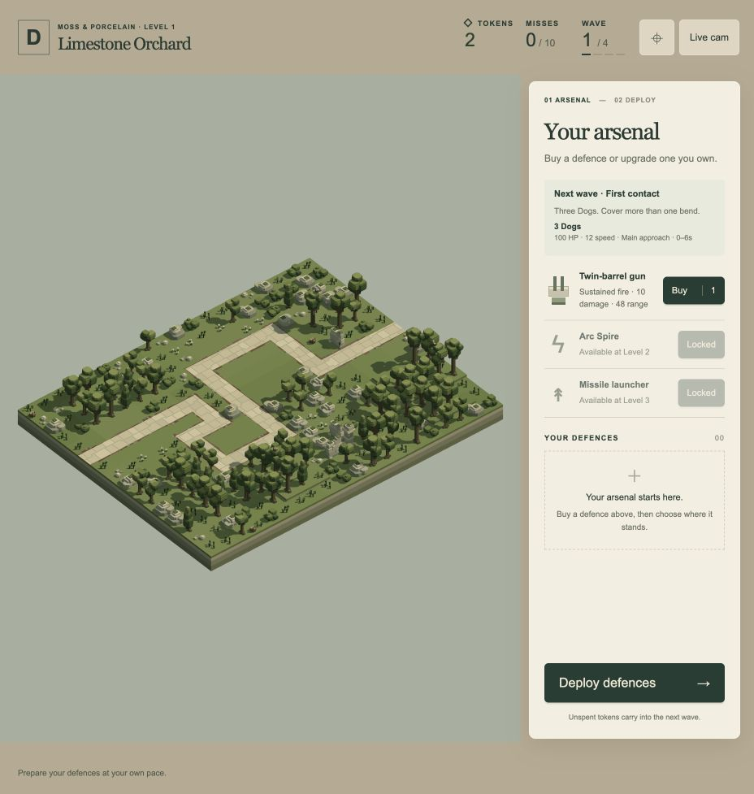

# Zone A complete for gameplay review — 20 October 2026

The user authorised completing Zone A and reviewing it before work on other zones. `/play/` now runs the four accepted A landscapes and sixteen authored waves, with Dogs, Rollers and Moths, family-aware inventory, staged gun/Arc/missile availability and a preparation briefing. Balance is implemented and verified for user playtesting; final difficulty acceptance remains provisional.

[Play the local build](http://127.0.0.1:4173/play/). The browser is left at fresh A1 preparation with two tokens and zero misses.



## Progression and tuning

- A1 introduces Dogs, then higher-health Rollers; A2 adds Moths and competing air/ground arrivals; A3 uses both accepted merging approaches; A4 culminates in a staged mixed finale.
- Gun base/I are initially available. A2 unlocks gun II and Arc base/I. A3 unlocks Arc II and missile base/I. A4 unlocks missile II. Prices remain gun 1, Arc 2 and missile 3 tokens for purchase and for each upgrade step.
- Gun ranges are now 48/66/84; Arc strength/range is 36/60, 48/84, 65/108; missile strength/range is 200/96, 280/126, 360/150. These profiles are isolated from the development previews. Existing attacks remain single-target.
- Enemy health/speed profiles stay consistent within a level. Moths use a play-only height of 44 to clear the complete gun barrel sweep while retaining real pitch/LOS requirements. Dogs/Rollers share each level's ground speed to prevent overtaking.
- The opening budget remains 2, rewards remain +2 per survived wave and failure remains ten cumulative misses. Ownership, tiers, misses and tokens carry through all three landscape transfers; preparation permits free repositioning. Completion follows A4 wave 4.
- The preparation panel shows effective enemy counts, health, speed, flight height, release windows and named approaches. Locked purchases/upgrades identify their first level. The arsenal scrolls while the start controls remain accessible.

Researcher and Tactician both conclude that the existing three species and three attack families are sufficient for this review. Generators/drones and additional types are not required to complete this Zone A configuration. See their [research review](RESEARCHER.md) and [encounter/balance handoff](TACTICIAN.md).

## Actual campaign evidence

[balance.json](balance.json) is the authoritative final run: production `PlaySession`, `loadPlayWorld` and `PlayEngine`; 120 Hz fixed simulation driven at 30 Hz; actual LOS, aim, contact, weapon/reload clocks, finite exits, persistent wallet and connected-wildlife deployment guards. All recorded load-bearing source hashes match the delivered files. There are 168 scheduled enemies in a complete Zone A run.

| Spending policy | Result | Misses | Spent before finale | Completion wallet including final reward |
| --- | --- | ---: | ---: | ---: |
| Mixed gun/Arc/missile | All 16 waves; 168 kills | 0 | 31 | 3 |
| Mixed after deliberately undeploying the bought opening guns | All 16 waves; 165 kills | 3, all in the opening | 31 | 3 |
| Continued gun investment | All 16 waves; 167 kills | 1 | 32 | 2 |
| Arc-focused after the gun opening | All 16 waves; 168 kills | 0 | 32 | 2 |
| Old two-gun, six-token plan | Defeat during A2.4 | 10 | 6 at defeat | — |
| Wide base-gun plan | Defeat during A2.3 | 10 | 14 at defeat | — |

The six policies total **79 wave attempts**. The final mixed wave's useful damage is gun 2,898, Arc 5,371 and missile 7,731. The clean mixed solution uses seven owned units, while the gun-focused comparison ends with eleven. These are feasible strategies, not proofs of minimum spending, optimal placements or human win rates. The recovery policy retains its purchased guns, actual tokens and three misses; it receives no free replacement, refund or reset.

Reproduce with:

```sh
bun scripts/zone-a-balance-audit.js --scenario=all --output=docs/zone-a-completion-2026-10-20/balance.json
```

## Verification and physical limits

**145 affected tests pass, 515,101 assertions, across seventeen files.** [Test log](affected-tests.log). The full suite was not run. This includes finite combat, actual missile contact, Arc attachments/absolute effect clocks, wave/level transitions, affordable family/tier gates, pause/settling/retry, strict light capacity, in-place GPU geometry identity, wildlife continuity and camera/acquisition regressions. Historical Dog-only camera fixtures preserve their original fights explicitly; mixed-roster checks use today's configuration.

[traffic.json](traffic.json) checks all sixteen unarmed schedules at 120 Hz with conservative animation cylinders; the minimum positive same-height margin is approximately 1.456 units. The independent [spacing audit](spacing.json) checks exact occupied local cuboids transformed by real poses using separating-axis tests: **35,215 sampled instants and 227,985 actor poses**, with no observed enemy/enemy, scenery/terrain or representative-defence overlap. It includes all unopposed schedules and six mixed-placement combat scenes. This is sampled evidence, not a continuous guarantee for every possible player arrangement. Actual gun pitch/LOS windows against the introductory Moths are recorded in [Researcher's review](RESEARCHER.md).

The [Engineer record](ENGINEER.md) documents finite pools, light membership and measured resource ownership. Eighteen species slots and thirty-six physical missile actors are reused. The affordable inventory bound is thirty-two base guns; the renderer's model-light capacity remains 128, with wave-specific light membership preventing disjoint pooled enemies from consuming the budget together. A synthetic strict 128-light boundary passes.

## Browser evidence

The ordinary player page was checked through real purchase, keyboard placement, automatic next selection, start, P pause/resume, an opening clean clear and a once-only +2 reward. [Player state/log capture](player-browser.json) records a fresh delivered run with sixteen-wave scope, correct locks and no production browser errors.

An isolated [GPU review viewer](http://127.0.0.1:4173/tools/zone-a-review.html) reads deployments from the authoritative campaign replay and uses the production configuration, renderer, combat controllers and effects. It does not modify `/play/` or author player settings. It verified mixed A3 combat/Live cam and A4's final wave, including real missile thrust, all three weapons, strict model lights and scene-resource release. A4's isolated final wave kills all fourteen enemies with no escapes; [state capture](a4-browser.json), [result image](a4-result.png). [A3 image](a3-mixed.png) and [state capture](a3-browser.json) were taken earlier in integration, before the final merge timing correction; they are visual evidence, not final balance provenance. The viewer's initial null-thrust reporting error was corrected before final review; it did not affect the player page.

Rendering was visually checked at the available desktop viewport. CPU submission observations are not GPU frame-time measurements or a laptop performance guarantee. The same-map geometry buffers remain stable; rebuilding a missile controller at preparation boundaries currently recreates its bounded 4,608-byte lazy thrust buffer. This is documented effect-buffer churn, not per-frame allocation.

## Preservation and remaining review

All 85 model/level JSON asset hashes match the pre-implementation manifest; [preservation result](preservation.json). Accepted routes, scenery, models, other-zone sources, authored conditions and the frozen backup are preserved. Shared controller extensions accept optional play profiles while retaining default preview profiles. No new unit type, enemy ability, splash/chaining rule, reward system or effect design was introduced.

The user should now review difficulty, pacing, clarity and preferred strategies. Zone A implementation is complete for that review; Zone B–D campaign progression remains deferred. Generator/drone inventory, save/resume, repairs and final campaign balance remain separate future scope.
