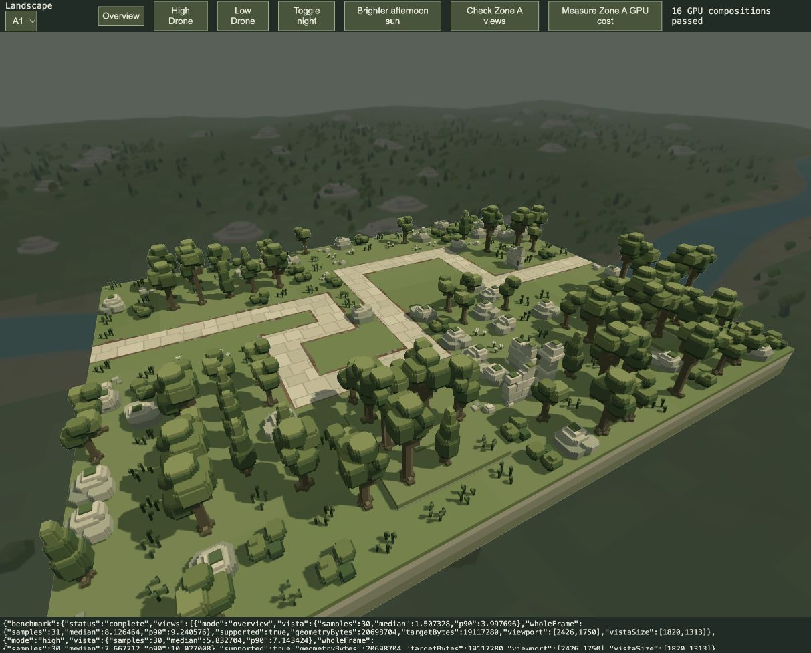

# Zone A vista fidelity trial · 21 October 2026

Implemented for review. The user requests a substantial skybox fidelity increase, beginning with Zone A and reviewing before moving to other zones. The production vista is a rendered distant landscape, not a cubemap.

A1–A4 retain the woodland valley/river identity and darker distance palette, with:

- 80-unit terrain facets instead of160, plus smaller folds in the woodland floor.
- More layered limestone benches, cap breaks and fallen slabs.
- Finer river segmentation and narrow irregular gravel shelves.
- More trees, with visible trunks, tiered cypresses, branching broadleaf crowns and low understory.
- 75%linear image resolution instead of50%, with1.8-source-texel softness instead of3.2. This lets the added detail survive the background filter while foreground rendering stays sharp.

Only Zone A changes appearance. B–D geometry hashes exactly match the before snapshot, and they retain the existing50%resolution/3.2filter. The shared composite now reads the vista filter radius from `Frame.options.w` (zero disables it), without expanding the368-byte uniform. B–D receive the same3.2value as the former shader constant.

Every vista vertex remains below gameplay (A maximum Y−246.8). Nothing enters collision, navigation, placement, combat, opaque depth or shadows. Accepted water/critters, asset sources and gameplay are untouched. Only the current zone's vista geometry and image pair are retained. The existing two-draw pass, cache invalidation, relighting, resize and resource release remain; no new pass or image asset is added.

## Geometry and memory

[Reproducible geometry audit](geometry-audit.mjs), [measurements](geometry-audit.json), [before source](baseline-vista-geometry.js).

| Resource | Before A | Trial A |
| --- | ---: | ---: |
| Vertices |137,133|862,446|
| Immutable vertex buffer |3,291,192bytes|20,698,704bytes|
| Vista images at2426×1750display |8,491,000bytes|19,117,280bytes|
| Bun generation median,5samples after warmup |6.40ms|40.54ms|

Geometry generation is load-time work, not per-frame work. The CPU generator temporarily uses a JS number array before creating the final typed payload; its peak heap cost is larger than the final vertex buffer. The nominal live GPU geometry+vista images increase by28,033,792bytes (about26.7MiB) at the measured viewport. Other render resources are unchanged. These are recorded costs, not agreed budgets or acceptance criteria.

## Exploratory GPU cost

The [before](baseline-gpu.json) and [after](new-gpu.json) runs use the same A1world and2426×1750physical viewport, no active simulation/actors, a small camera yaw sweep and asynchronous timestamp queries. The diagnostic performs a separately timestamped replay of the actual vista pass alongside the complete production render span. Each vista view has30samples after350ms warmup; full-frame counts are30or31. The extra replay makes this a controlled review diagnostic rather than normal gameplay.

| Camera | Full-span median before | Trial | Difference |
| --- | ---: | ---: | ---: |
| Overview |6.029ms|8.126ms|+2.097ms|
| High Drone |6.095ms|7.668ms|+1.573ms|
| Low Drone |5.964ms|8.061ms|+2.097ms|

The isolated vista medians are inconsistent: before4.063/4.194/0.328ms and after1.507/5.833/6.291ms for overview/high/low. That variability prevents a trustworthy exact per-pass delta. The whole-span increase is the more consistent observation in this limited run. No combat FPS, hardware-independent budget or headroom guarantee is claimed. The trial remains for user review.

## Verification and review

- [32 targeted vista/renderer tests pass](targeted-tests.log): deterministic finite geometry, valid triangles/colours, battlefield-relative centering, matching-zone ownership, B–D preservation, cache reuse, resized target accounting, lighting and complete resource release.
- [16 actual GPU compositions pass](a1-a4-gpu-checks.json): A1–A4 overview/high Drone/low Drone/night. Recorded errors are empty.
- The [review tool](http://127.0.0.1:4173/tools/zone-vista-review.html) is left on A1High Drone. It loads actual playable landscape sources without starting combat. No existing player run is reloaded. Zone A's production path will use this trial on its next application load.

[Before](baseline-high.jpg) · [Trial](new-high.jpg)

Review appearance and cost before any B–D fidelity upgrade. No further zone upgrade is authorised yet.
